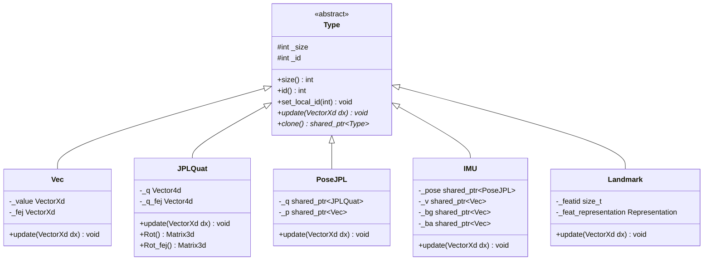

# 01. 数学基础与状态表征 (Mathematics & State Representation)

本章深入探讨 OpenVINS 系统的数学基础、旋转理论、状态空间建模与切空间误差状态表示，并详尽剖析代码层面的面向对象抽象与协方差存储机制。

---

## 1. 参考坐标系与空间刚体变换

在视觉惯性里程计（VIO）中，状态估计本质上是在处理不同参考坐标系之间的空间位姿变换。OpenVINS 严格定义并遵循以下坐标系规范：

```
                      +Z_G (背离重力向上)
                       ^
                       |
                       |  全局坐标系 {G}
                       +--------> +Y_G
                      /
                     v +X_G

      +Z_I                       +Z_C (光轴正前方)
       ^                          ^
       |  IMU机体系 {I}           |   相机光学系 {C}
       +-----> +Y_I               +-----> +X_C
      /                          /
     v +X_I                     v +Y_C (图像向下)
```

1. **全局惯性坐标系 $\{G\}$ (Global Frame)**：
   - 假定为理想惯性系，重力加速度矢量在 $\{G\}$ 下恒定为 ${}^G\mathbf{g} = [0, 0, -g]^\top$（当采用标准右手系且 $Z$ 轴背离重力向上时，注意 OpenVINS 源码中重力定义为沿 $+Z$ 方向分量为 positive gravity magnitude，运动学方程中减去重力，见后续推导）。
2. **机体/IMU坐标系 $\{I\}$ (IMU Body Frame)**：
   - 固连在 IMU 敏感元件中心，随载体做空间六自由度运动。线加速度计和角速度陀螺仪的原始读数均在此系下表达。
3. **相机坐标系 $\{C\}$ (Camera Frame)**：
   - 遵循标准计算机视觉坐标系约定：$Z$ 轴沿镜头光轴向外指向前方，$X$ 轴沿成像平面水平向右，$Y$ 轴沿成像平面垂直向下。
4. **克隆位姿坐标系 $\{I_k\}$ (Cloned IMU Pose Frame)**：
   - 在第 $k$ 帧图像曝光时刻 IMU 所在的机体坐标系，作为滑动窗口中的观测历史基准。

### 空间点坐标转换方程
设空间中存在某个静态三维路标点，其在全局系下的三维坐标为 ${}^G\mathbf{p}_f$。
- 其在当前 IMU 机体系 $\{I\}$ 下的坐标为：
  $$
  {}^I\mathbf{p}_f = {}^I_G\mathbf{R} \left( {}^G\mathbf{p}_f - {}^G\mathbf{p}_I \right)
  $$
  其中 ${}^I_G\mathbf{R} \in SO(3)$ 表示从全局系 $\{G\}$ 到 IMU 系 $\{I\}$ 的旋转矩阵；${}^G\mathbf{p}_I \in \mathbb{R}^3$ 表示 IMU 在全局系下的位置向量。
- 进一步转换到相机坐标系 $\{C\}$ 下（利用相机与 IMU 之间的外参矩阵 ${}^C_I\mathbf{R}$ 和平移 ${}^C\mathbf{p}_I = -{}^C_I\mathbf{R}{}^I\mathbf{p}_C$）：
  $$
  {}^C\mathbf{p}_f = {}^C_I\mathbf{R} {}^I\mathbf{p}_f + {}^C\mathbf{p}_I = {}^C_I\mathbf{R} \left( {}^I_G\mathbf{R} \left( {}^G\mathbf{p}_f - {}^G\mathbf{p}_I \right) - {}^I\mathbf{p}_C \right)
  $$
  在 OpenVINS 源码实现中，外参通常显式维护为 ${}^C_I\mathbf{R}$（即代码中的 `R_ItoC`）与 ${}^I\mathbf{p}_C$（即 IMU 坐标系下相机光心的平移 `p_IinC`），因此点投影公式写为：
  $$
  {}^C\mathbf{p}_f = {}^C_I\mathbf{R} \cdot {}^I\mathbf{p}_f + {}^I\mathbf{p}_C \quad \text{或直接根据标定定义解算}
  $$

---

## 2. JPL 四元数理论体系 vs Hamilton 体系深度对比

在机器人与状态估计领域，四元数存在两大主流约定：**Hamilton 约定**（Eigen, ROS tf, Ceres 常用）与 **JPL 约定**（NASA JPL 喷气推进实验室，Trawny & Roumeliotis 2005 经典报告，OpenVINS 所采用）。若混淆两者，会导致旋转复合符号相反、雅可比推导全盘错误。

### 2.1 四元数基本定义与乘法表

一个四元数由一个实部标量与三个虚部向量构成：
$$
\bar{q} = q_4 + q_1 \mathbf{i} + q_2 \mathbf{j} + q_3 \mathbf{k}
$$
其虚数基底满足：
$$
\mathbf{i}^2 = \mathbf{j}^2 = \mathbf{k}^2 = -1
$$
**最核心的分歧在于虚数乘积规则**：
- **Hamilton 约定**（右手法则）：
  $$
  \mathbf{i}\mathbf{j} = \mathbf{k}, \quad \mathbf{j}\mathbf{k} = \mathbf{i}, \quad \mathbf{k}\mathbf{i} = \mathbf{j}
  $$
- **JPL 约定**（左手法则，符合无源被动坐标变换系统）：
  $$
  \mathbf{i}\mathbf{j} = -\mathbf{k}, \quad \mathbf{j}\mathbf{k} = -\mathbf{i}, \quad \mathbf{k}\mathbf{i} = -\mathbf{j}
  $$

### 2.2 数据存储与向量拆分

OpenVINS 采用如下的 $4\times 1$ 列向量表示 JPL 四元数（向量在前，标量在后）：
$$
\bar{q} = \begin{bmatrix} q_1 \\ q_2 \\ q_3 \\ q_4 \end{bmatrix} = \begin{bmatrix} \mathbf{q} \\ q_4 \end{bmatrix}, \quad \text{满足单位模长约束} \quad |\bar{q}|^2 = \mathbf{q}^\top \mathbf{q} + q_4^2 = 1
$$
其中 $q_4 \ge 0$ 用以保证四元数表示的单射唯一性（Double-cover 性质）。

### 2.3 JPL 四元数乘法与矩阵形式

设两个 JPL 四元数 $\bar{q} = [\mathbf{q}^\top, q_4]^\top$ 与 $\bar{p} = [\mathbf{p}^\top, p_4]^\top$，其四元数乘积 $\bar{q} \otimes \bar{p}$ 对应于左乘矩阵 $\mathcal{L}(\bar{q})$ 与右乘矩阵 $\mathcal{R}(\bar{p})$：
$$
\bar{q} \otimes \bar{p} = \mathcal{L}(\bar{q}) \bar{p} = \mathcal{R}(\bar{p}) \bar{q}
$$
在 JPL 约定下，左乘算子展开为：
$$
\mathcal{L}(\bar{q}) = \begin{bmatrix} q_4 \mathbf{I}_3 - \lfloor\mathbf{q}\times\rfloor & \mathbf{q} \\ -\mathbf{q}^\top & q_4 \end{bmatrix}
$$
右乘算子展开为：
$$
\mathcal{R}(\bar{p}) = \begin{bmatrix} p_4 \mathbf{I}_3 + \lfloor\mathbf{p}\times\rfloor & \mathbf{p} \\ -\mathbf{p}^\top & p_4 \end{bmatrix}
$$
> **源码对照**：打开 [ov_core/src/utils/quat_ops.h](../ov_core/src/utils/quat_ops.h#L182-L200) 中的 `quat_multiply` 函数：
> ```cpp
> Qm.block(0, 0, 3, 3) = q(3, 0) * Eigen::MatrixXd::Identity(3, 3) - skew_x(q.block(0, 0, 3, 1));
> Qm.block(0, 3, 3, 1) = q.block(0, 0, 3, 1);
> Qm.block(3, 0, 1, 3) = -q.block(0, 0, 3, 1).transpose();
> Qm(3, 3) = q(3, 0);
> q_t = Qm * p;
> ```
> 注意矩阵左上角的符号为 `-skew_x(q.block(0, 0, 3, 1))`，这是 JPL 四元数乘法的典型特征！

### 2.4 JPL 四元数到 SO(3) 旋转矩阵的转换

在 JPL 约定下，四元数 $\bar{q} = [\mathbf{q}^\top, q_4]^\top$ 诱导的旋转矩阵计算公式为（Trawny 2005, Eq. 62）：
$$
\mathbf{R}(\bar{q}) = (2 q_4^2 - 1)\mathbf{I}_3 - 2 q_4 \lfloor\mathbf{q}\times\rfloor + 2 \mathbf{q}\mathbf{q}^\top
$$
> **源码对照**：参见 [ov_core/src/utils/quat_ops.h](../ov_core/src/utils/quat_ops.h#L161-L167) 中的 `quat_2_Rot` 函数：
> ```cpp
> Eigen::Matrix<double, 3, 3> q_x = skew_x(q.block(0, 0, 3, 1));
> Eigen::MatrixXd Rot = (2 * std::pow(q(3, 0), 2) - 1) * Eigen::MatrixXd::Identity(3, 3) 
>                     - 2 * q(3, 0) * q_x 
>                     + 2 * q.block(0, 0, 3, 1) * (q.block(0, 0, 3, 1).transpose());
> ```

连续复合两次旋转时，若先经历旋转 $\bar{q}_1$ 再经历旋转 $\bar{q}_2$，其旋转矩阵满足：
$$
\mathbf{R}(\bar{q}_2 \otimes \bar{q}_1) = \mathbf{R}(\bar{q}_2) \mathbf{R}(\bar{q}_1)
$$
这保证了四元数代数复合顺序与矩阵乘法复合顺序完全一致。

---

## 3. 李群李代数与误差状态流形表征 ($\boxplus / \boxminus$)

三维旋转构成了非线性李群 $SO(3)$，直接对其进行加减法运算会破坏正交性与单位模长约束。因此，现代 VIO 普遍采用误差状态卡尔曼滤波（ESKF），在流形的切空间（Tangent Space）上进行滤波更新。

### 3.1 姿态误差定义（JPL 左乘扰动）

OpenVINS 采用**左乘四元数误差**（Left-multiplicative error state）：
$$
{}^I_G\bar{q} \simeq \delta\bar{q} \otimes {}^I_G\hat{\bar{q}} = \begin{bmatrix} \frac{1}{2}\delta\boldsymbol{\theta} \\ 1 \end{bmatrix} \otimes {}^I_G\hat{\bar{q}}
$$
其中：
- ${}^I_G\bar{q}$ 为未知真值姿态；
- ${}^I_G\hat{\bar{q}}$ 为当前滤波器估计均值；
- $\delta\boldsymbol{\theta} \in \mathbb{R}^3$ 为切空间中的三维微小角误差向量（即李代数 $\mathfrak{so}(3)$ 扰动）；
- $\delta\bar{q} \approx \begin{bmatrix} \frac{1}{2}\delta\boldsymbol{\theta} \\ 1 \end{bmatrix}$ 为一阶近似的小扰动四元数。

将此式代入旋转矩阵映射公式，可推导对应的旋转矩阵一阶近似：
$$
\begin{aligned}
{}^I_G\mathbf{R} &= \mathbf{R}(\delta\bar{q}) {}^I_G\hat{\mathbf{R}} \\
&\approx \exp(-\lfloor\delta\boldsymbol{\theta}\times\rfloor) {}^I_G\hat{\mathbf{R}} \\
&\approx (\mathbf{I}_3 - \lfloor\delta\boldsymbol{\theta}\times\rfloor) {}^I_G\hat{\mathbf{R}}
\end{aligned}
$$
> **重要物理意义**：
> 这里的负号源于 JPL 的坐标变换投影约定。当机体发生小旋转扰动时，测得的局部加速度向量转换到全局系下的误差将与该反对称算子直接耦合。

### 3.2 广义加减法算子 ($\boxplus, \boxminus$)

对于流形上的复合变量 $\mathbf{x} \in \mathcal{M}$ 与切空间扰动 $\delta\mathbf{x} \in \mathbb{R}^n$，定义：
- **Retraction 算子 ($\boxplus$)**：将切空间微元映射回流形：
  $$
  \mathbf{x} = \hat{\mathbf{x}} \boxplus \delta\mathbf{x}
  $$
  - 对于欧氏空间向量（位置、速度、偏置）：$\mathbf{p} = \hat{\mathbf{p}} + \delta\mathbf{p}$；
  - 对于 JPL 四元数：
    $$
    \bar{q} = \text{normalize}\left( \begin{bmatrix} \frac{1}{2}\delta\boldsymbol{\theta} \\ 1 \end{bmatrix} \otimes \hat{\bar{q}} \right)
    $$
- **Inverse Retraction 算子 ($\boxminus$)**：计算两流形状态在切空间上的差异：
  $$
  \delta\mathbf{x} = \mathbf{x} \boxminus \hat{\mathbf{x}}
  $$

---

## 4. OpenVINS 完整状态向量设计

OpenVINS 采用经典的滑动窗口状态向量架构，能够同时维护当前 IMU 运动状态、历史相机克隆位姿、在线标定参数以及持久 SLAM 特征点。

系统在 $t_k$ 时刻的完整真实状态向量定义如下：

$$
\mathbf{x}_k = \begin{bmatrix}
\mathbf{x}_I^\top & \mathbf{x}_{calib}^\top & \mathbf{x}_C^\top & \mathbf{x}_L^\top
\end{bmatrix}^\top
$$

### 4.1 核心活跃 IMU 状态 $\mathbf{x}_I$（16维状态，15维误差）

$$
\mathbf{x}_I = \begin{bmatrix}
{}^I_G\bar{q}^\top & {}^G\mathbf{p}_I^\top & {}^G\mathbf{v}_I^\top & \mathbf{b}_g^\top & \mathbf{b}_a^\top
\end{bmatrix}^\top \in \mathbb{R}^{16}
$$
对应的切空间误差状态：
$$
\tilde{\mathbf{x}}_I = \begin{bmatrix}
{}^I_G\delta\boldsymbol{\theta}^\top & {}^G\tilde{\mathbf{p}}_I^\top & {}^G\tilde{\mathbf{v}}_I^\top & \tilde{\mathbf{b}}_g^\top & \tilde{\mathbf{b}}_a^\top
\end{bmatrix}^\top \in \mathbb{R}^{15}
$$
- ${}^I_G\bar{q}$：当前 IMU 姿态四元数（误差维度 3）；
- ${}^G\mathbf{p}_I$：当前 IMU 在全局系下的位置（误差维度 3）；
- ${}^G\mathbf{v}_I$：当前 IMU 在全局系下的线速度（误差维度 3）；
- $\mathbf{b}_g$：陀螺仪零偏随机游走偏置（误差维度 3）；
- $\mathbf{b}_a$：线加速度计零偏随机游走偏置（误差维度 3）。

### 4.2 相机克隆位姿滑动窗口 $\mathbf{x}_C$（$6N$ 维误差）

维护过去 $N$ 帧图像曝光时刻捕获的 IMU 位姿克隆副本：
$$
\mathbf{x}_C = \begin{bmatrix}
{}^{I_{c_1}}_G\bar{q}^\top & {}^G\mathbf{p}_{I_{c_1}}^\top & \cdots & {}^{I_{c_N}}_G\bar{q}^\top & {}^G\mathbf{p}_{I_{c_N}}^\top
\end{bmatrix}^\top
$$
对应的切空间误差状态：
$$
\tilde{\mathbf{x}}_C = \begin{bmatrix}
{}^{I_{c_1}}_G\delta\boldsymbol{\theta}^\top & {}^G\tilde{\mathbf{p}}_{I_{c_1}}^\top & \cdots & {}^{I_{c_N}}_G\delta\boldsymbol{\theta}^\top & {}^G\tilde{\mathbf{p}}_{I_{c_N}}^\top
\end{bmatrix}^\top \in \mathbb{R}^{6N}
$$

### 4.3 在线传感器标定状态 $\mathbf{x}_{calib}$

OpenVINS 支持强大的多相机与 IMU 空间、时间全方位在线自标定：
$$
\mathbf{x}_{calib} = \begin{bmatrix}
\mathbf{x}_{cam\_ext}^\top & \mathbf{x}_{cam\_int}^\top & t_d & \mathbf{x}_{imu\_int}^\top
\end{bmatrix}^\top
$$
1. **相机外参状态 $\mathbf{x}_{cam\_ext}$**：每个相机的空间刚体变换 $\{{}^{C_i}_I\bar{q}, {}^I\mathbf{p}_{C_i}\}$（每个相机 $6$ 维误差）。
2. **相机内参状态 $\mathbf{x}_{cam\_int}$**：焦距、主点与畸变系数（根据模型不同为 $4\sim 8$ 维）。
3. **相机-IMU 时间偏移 $t_d$**：描述相机时钟与 IMU 时钟的时间戳偏差（1 维），物理模型为 $t_{imu} = t_{cam} + t_d$。
4. **IMU 内参状态 $\mathbf{x}_{imu\_int}$**：
   - 陀螺仪轴系尺度与不正交矩阵 $\mathbf{D}_w$（6 维）；
   - 加速度计轴系尺度与不正交矩阵 $\mathbf{D}_a$（6 维）；
   - 陀螺仪重力敏感度耦合矩阵 $\mathbf{T}_g$（9 维）；
   - 加速度计与陀螺仪坐标系之间的微小相对旋转 ${}^{A}_G\bar{q}$（3 维）。

### 4.4 长期 SLAM 路标状态 $\mathbf{x}_L$

与 MSCKF 测量在窗口边缘被边缘化不同，被选定为 SLAM 特征的点将被加入滤波状态向量中跨窗口长期追踪：
$$
\mathbf{x}_L = \begin{bmatrix}
\mathbf{f}_1^\top & \mathbf{f}_2^\top & \cdots & \mathbf{f}_M^\top
\end{bmatrix}^\top
$$
根据参数化选择不同，每个路标在状态中占据 3 维（如全局 3D 坐标、锚定坐标）或 1 维（单深度/逆深度）。

---

## 5. 协方差矩阵存储机制与切空间组织

在 C++ 工程落地中，状态向量是异构的（四元数具有 4 个标量但切空间自由度为 3，位置有 3 个标量自由度为 3）。协方差矩阵严格对应于所有变量的切空间误差维度之和：
$$
\mathbf{P} = \mathbb{E}\left[ \tilde{\mathbf{x}} \tilde{\mathbf{x}}^\top \right] \in \mathbb{R}^{D \times D}, \quad D = \sum_{k} \dim(\tilde{\mathbf{x}}_k)
$$

其典型的协方差分块结构如下所示：

$$
\mathbf{P} = \begin{bmatrix}
\mathbf{P}_{II} & \mathbf{P}_{I,calib} & \mathbf{P}_{IC} & \mathbf{P}_{IL} \\
\mathbf{P}_{calib,I} & \mathbf{P}_{calib,calib} & \mathbf{P}_{calib,C} & \mathbf{P}_{calib,L} \\
\mathbf{P}_{CI} & \mathbf{P}_{C,calib} & \mathbf{P}_{CC} & \mathbf{P}_{CL} \\
\mathbf{P}_{LI} & \mathbf{P}_{L,calib} & \mathbf{P}_{LC} & \mathbf{P}_{LL}
\end{bmatrix}
$$

各分块物理意义：
- $\mathbf{P}_{II} (15\times 15)$：活跃 IMU 当前运动学误差协方差；
- $\mathbf{P}_{CC} (6N \times 6N)$：滑动窗口中各历史克隆位姿自身及其相互之间的自协方差和互协方差；
- $\mathbf{P}_{IC} (15 \times 6N)$：活跃 IMU 与克隆位姿之间的交叉相关项（在状态克隆与 IMU 积分时建立）；
- $\mathbf{P}_{LL}$：持久 SLAM 路标点之间的几何相关性。

---

## 6. 源码工程级面向对象设计与实现

OpenVINS 在 `ov_core` 和 `ov_msckf` 中建立了非常优美且扩展性极强的类型管理系统。



### 6.1 `ov_type::Type` 基类设计
文件路径：[ov_core/src/types/Type.h](../ov_core/src/types/Type.h#L38-L90)
- `_size`：该变量在切空间中的自由度（例如 `JPLQuat` 为 3，`Vec` 为其实际向量维度）。
- `_id`：该变量在整个滤波器大协方差矩阵 $\mathbf{P}$ 中的起始行/列偏移索引。若变量不在当前协方差中（例如某些临时优化变量），则标记为 `-1`。
- `virtual void update(const Eigen::VectorXd &dx) = 0`：纯虚函数，子类必须实现流形上的 $\boxplus$ 局部更新操作。

### 6.2 `ov_type::JPLQuat` 类的流形更新实现
文件路径：[ov_core/src/types/JPLQuat.h](../ov_core/src/types/JPLQuat.h#L110-L135)
```cpp
void update(const Eigen::VectorXd &dx) override {
  assert(dx.rows() == _size);

  // 1. 根据 3维角误差 dx 构建小扰动四元数 dq
  Eigen::Matrix<double, 4, 1> dq;
  dq << .5 * dx, 1.0;

  // 2. 左乘当前估计四元数: q_new = dq (x) q_old
  Eigen::Matrix<double, 4, 1> q_new = ov_core::quat_multiply(dq, _q);

  // 3. 归一化并写回
  set_value_internal(ov_core::quatnorm(q_new));
}
```
这段代码直接呼应了前述公式 ${}^I_G\bar{q} \leftarrow \text{normalize}\left(\begin{bmatrix} \frac{1}{2}\delta\boldsymbol{\theta} \\ 1 \end{bmatrix} \otimes {}^I_G\hat{\bar{q}}\right)$。

### 6.3 `ov_msckf::State` 与 `ov_msckf::StateHelper` 的友元安全机制
文件路径：[ov_msckf/src/state/State.h](../ov_msckf/src/state/State.h#L180-L240) 与 [ov_msckf/src/state/StateHelper.h](../ov_msckf/src/state/StateHelper.h)

在 OpenVINS 中，大协方差矩阵 `Eigen::MatrixXd _Cov` 是 `State` 类的 `private` 成员，并且其所有直接增删改操作都被严格限制。`State` 类声明 `friend class StateHelper;`，这意味着：
- **普通开发者或外部函数无法随意修改协方差矩阵的尺寸与元素**；
- 所有的协方差扩增（克隆）、边缘化（消元）、初始化（路标注入）和 EKF 矩阵更新，必须且只能通过静态工具类 `StateHelper` 的标准接口执行；
- 这在工程架构上从根本上避免了因“手动添加克隆状态却漏更新交叉协方差”或“边缘化变量后全局索引错位”引发的灾难性悬挂内存与协方差非正定崩溃。
