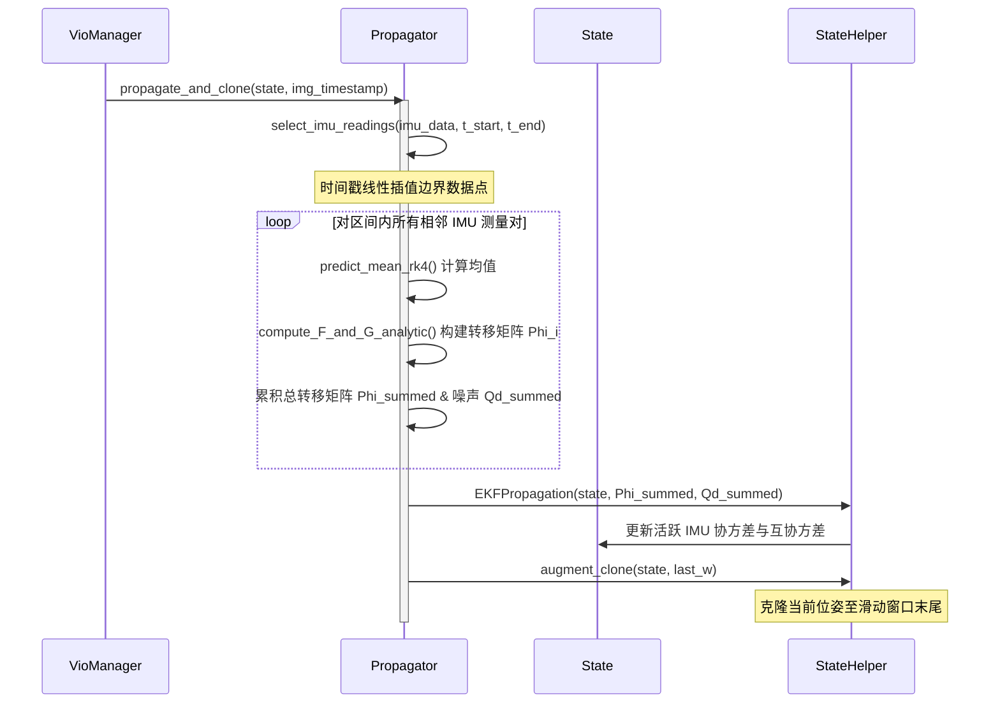

# 02. IMU 运动学传播与连续预积分 (IMU Propagation & Continuous Preintegration)

本章详尽推导基于惯性测量单元（IMU）的连续时间运动学模型、切空间误差动力学微分方程、状态转移矩阵 $\boldsymbol{\Phi}$ 与离散过程噪声协方差 $\mathbf{Q}_d$ 的解析及离散数值求解，并深入剖析 4 阶 Runge-Kutta (RK4) 均值积分与连续预积分（CPIv1 / CPIv2）理论，最后进行源码行级精读。

---

## 1. IMU 传感器物理测量模型与连续时间动力学

惯性测量单元（IMU）通常包含三轴正交的微机电（MEMS）陀螺仪与加速度计。其输出信号受高斯白噪声与低频零偏随机游走驱动。

### 1.1 传感器测量物理模型

在连续时间 $t$，传感器测得的角速度 $\boldsymbol{\omega}_m(t)$ 与比力加速度 $\mathbf{a}_m(t)$ 建模为：
$$
\begin{aligned}
\boldsymbol{\omega}_m(t) &= \boldsymbol{\omega}(t) + \mathbf{b}_g(t) + \mathbf{w}_g(t) \\
\mathbf{a}_m(t) &= {}^I\mathbf{R}_G(t) \left( {}^G\mathbf{a}(t) - {}^G\mathbf{g} \right) + \mathbf{b}_a(t) + \mathbf{w}_a(t)
\end{aligned}
$$
其中：
- $\boldsymbol{\omega}(t)$ 为机体在惯性系下的真实角速度；
- ${}^G\mathbf{a}(t) = \ddot{{}^G\mathbf{p}}_I(t)$ 为 IMU 在全局系下的真实几何线加速度；
- ${}^G\mathbf{g} = [0, 0, -g]^\top$ 为惯性系下的重力加速度矢量；
- $\mathbf{b}_g(t), \mathbf{b}_a(t)$ 为传感器零偏（Bias）；
- $\mathbf{w}_g(t) \sim \mathcal{N}(\mathbf{0}, \sigma_g^2 \mathbf{I}_3)$，$\mathbf{w}_a(t) \sim \mathcal{N}(\mathbf{0}, \sigma_a^2 \mathbf{I}_3)$ 分别为连续时间高斯白噪声。

零偏的时变特性采用维纳过程（Brownian Motion / Random Walk）建模：
$$
\dot{\mathbf{b}}_g(t) = \mathbf{w}_{bg}(t), \quad \dot{\mathbf{b}}_a(t) = \mathbf{w}_{ba}(t)
$$
其中 $\mathbf{w}_{bg}(t) \sim \mathcal{N}(\mathbf{0}, \sigma_{bg}^2 \mathbf{I}_3)$，$\mathbf{w}_{ba}(t) \sim \mathcal{N}(\mathbf{0}, \sigma_{ba}^2 \mathbf{I}_3)$ 为随机游走驱动噪声。

### 1.2 连续时间真实状态微分方程

根据刚体空间运动学，在 JPL 坐标约定下，IMU 状态向量 $\mathbf{x}_I(t) = [{}^I\bar{q}_G^\top, {}^G\mathbf{p}_I^\top, {}^G\mathbf{v}_I^\top, \mathbf{b}_g^\top, \mathbf{b}_a^\top]^\top$ 满足如下非线性常微分方程组：
$$
\begin{aligned}
{}^I\dot{\bar{q}}_G(t) &= \frac{1}{2} \boldsymbol{\Omega}(\boldsymbol{\omega}(t)) {}^I\bar{q}_G(t) = \frac{1}{2} \begin{bmatrix} -\lfloor\boldsymbol{\omega}(t)\times\rfloor & \boldsymbol{\omega}(t) \\ -\boldsymbol{\omega}(t)^\top & 0 \end{bmatrix} {}^I\bar{q}_G(t) \\
{}^G\dot{\mathbf{p}}_I(t) &= {}^G\mathbf{v}_I(t) \\
{}^G\dot{\mathbf{v}}_I(t) &= {}^I\mathbf{R}_G(t)^\top \mathbf{a}(t) + {}^G\mathbf{g} \\
\dot{\mathbf{b}}_g(t) &= \mathbf{w}_{bg}(t) \\
\dot{\mathbf{b}}_a(t) &= \mathbf{w}_{ba}(t)
\end{aligned}
$$
其中比力真值为 $\mathbf{a}(t) = \mathbf{a}_m(t) - \mathbf{b}_a(t) - \mathbf{w}_a(t)$，角速度真值为 $\boldsymbol{\omega}(t) = \boldsymbol{\omega}_m(t) - \mathbf{b}_g(t) - \mathbf{w}_g(t)$。

> **关于重力符号的工程注记**：
> 在 OpenVINS 内部，为保证重力幅值正标量定义，代码中设 $\mathbf{g}_{ov} = [0, 0, g]^\top$（$g \approx 9.81$），因此速度导数在代码中写为：
> `${}^G\dot{\mathbf{v}}_I(t) = {}^I\mathbf{R}_G(t)^\top \mathbf{a}(t) - \mathbf{g}_{ov}$`。推导时与此保持一致。

---

## 2. 切空间误差状态连续时间动力学推导

为进行卡尔曼滤波递推，需将真实非线性动力学关于当前估计均值 $\hat{\mathbf{x}}_I(t)$ 进行一阶 Taylor 展开，建立线性化的误差状态微分方程：
$$
\dot{\tilde{\mathbf{x}}}_I(t) = \mathbf{F}_c(t) \tilde{\mathbf{x}}_I(t) + \mathbf{G}_c(t) \mathbf{w}(t)
$$
其中误差状态为：
$$
\tilde{\mathbf{x}}_I(t) = \begin{bmatrix} \delta\boldsymbol{\theta}(t)^\top & {}^G\tilde{\mathbf{p}}_I(t)^\top & {}^G\tilde{\mathbf{v}}_I(t)^\top & \tilde{\mathbf{b}}_g(t)^\top & \tilde{\mathbf{b}}_a(t)^\top \end{bmatrix}^\top \in \mathbb{R}^{15}
$$
驱动噪声向量为：
$$
\mathbf{w}(t) = \begin{bmatrix} \mathbf{w}_g(t)^\top & \mathbf{w}_a(t)^\top & \mathbf{w}_{bg}(t)^\top & \mathbf{w}_{ba}(t)^\top \end{bmatrix}^\top \in \mathbb{R}^{12}
$$

### 2.1 姿态误差动力学推导 ($\delta\dot{\boldsymbol{\theta}}$)

根据第 01 章 JPL 左乘误差四元数定义：
$$
{}^I\bar{q}_G \simeq \delta\bar{q} \otimes {}^I\hat{\bar{q}}_G \approx \begin{bmatrix} \frac{1}{2}\delta\boldsymbol{\theta} \\ 1 \end{bmatrix} \otimes {}^I\hat{\bar{q}}_G
$$
两边对时间 $t$ 求导，并利用四元数求导链式法则：
$$
{}^I\dot{\bar{q}}_G = \delta\dot{\bar{q}} \otimes {}^I\hat{\bar{q}}_G + \delta\bar{q} \otimes {}^I\dot{\hat{\bar{q}}}_G
$$
将运动学方程代入左边和右边：
$$
\frac{1}{2}\begin{bmatrix} \boldsymbol{\omega} \\ 0 \end{bmatrix}_R \otimes \delta\bar{q} \otimes {}^I\hat{\bar{q}}_G = \begin{bmatrix} \frac{1}{2}\delta\dot{\boldsymbol{\theta}} \\ 0 \end{bmatrix} \otimes {}^I\hat{\bar{q}}_G + \delta\bar{q} \otimes \left( \frac{1}{2}\begin{bmatrix} \hat{\boldsymbol{\omega}} \\ 0 \end{bmatrix}_R \otimes {}^I\hat{\bar{q}}_G \right)
$$
两边右侧同时消去 $\otimes {}^I\hat{\bar{q}}_G$，并利用小量一阶近似展开，可严格导出切空间姿态角误差微分方程：
$$
\delta\dot{\boldsymbol{\theta}}(t) = -\lfloor\hat{\boldsymbol{\omega}}(t)\times\rfloor \delta\boldsymbol{\theta}(t) - \tilde{\mathbf{b}}_g(t) - \mathbf{w}_g(t)
$$
其中估计角速度 $\hat{\boldsymbol{\omega}}(t) = \boldsymbol{\omega}_m(t) - \hat{\mathbf{b}}_g(t)$。

### 2.2 速度误差动力学推导 (${}^G\dot{\tilde{\mathbf{v}}}_I$)

真实速度导数为：
$$
{}^G\dot{\mathbf{v}}_I = {}^I\mathbf{R}_G^\top (\mathbf{a}_m - \mathbf{b}_a - \mathbf{w}_a) - \mathbf{g}
$$
估计速度导数为：
$$
{}^G\dot{\hat{\mathbf{v}}}_I = {}^I\hat{\mathbf{R}}_G^\top (\mathbf{a}_m - \hat{\mathbf{b}}_a) - \mathbf{g}
$$
利用第 01 章旋转矩阵近似关系 ${}^I\mathbf{R}_G \approx (\mathbf{I}_3 - \lfloor\delta\boldsymbol{\theta}\times\rfloor) {}^I\hat{\mathbf{R}}_G$，其转置为：
$$
{}^I\mathbf{R}_G^\top \approx {}^I\hat{\mathbf{R}}_G^\top (\mathbf{I}_3 + \lfloor\delta\boldsymbol{\theta}\times\rfloor)
$$
将此式代入真实速度导数中：
$$
\begin{aligned}
{}^G\dot{\mathbf{v}}_I &= {}^I\hat{\mathbf{R}}_G^\top (\mathbf{I}_3 + \lfloor\delta\boldsymbol{\theta}\times\rfloor) \left( \hat{\mathbf{a}} - \tilde{\mathbf{b}}_a - \mathbf{w}_a \right) - \mathbf{g} \\
&\approx {}^I\hat{\mathbf{R}}_G^\top \hat{\mathbf{a}} + {}^I\hat{\mathbf{R}}_G^\top \lfloor\delta\boldsymbol{\theta}\times\rfloor \hat{\mathbf{a}} - {}^I\hat{\mathbf{R}}_G^\top \tilde{\mathbf{b}}_a - {}^I\hat{\mathbf{R}}_G^\top \mathbf{w}_a - \mathbf{g}
\end{aligned}
$$
利用向量外积反对称恒等式 $\lfloor\delta\boldsymbol{\theta}\times\rfloor \hat{\mathbf{a}} = -\lfloor\hat{\mathbf{a}}\times\rfloor \delta\boldsymbol{\theta}$，并将上式减去估计值导数，得到：
$$
{}^G\dot{\tilde{\mathbf{v}}}_I(t) = -{}^I\hat{\mathbf{R}}_G(t)^\top \lfloor\hat{\mathbf{a}}(t)\times\rfloor \delta\boldsymbol{\theta}(t) - {}^I\hat{\mathbf{R}}_G(t)^\top \tilde{\mathbf{b}}_a(t) - {}^I\hat{\mathbf{R}}_G(t)^\top \mathbf{w}_a(t)
$$

### 2.3 位置与零偏误差动力学

位置误差导数显而易见：
$$
{}^G\dot{\tilde{\mathbf{p}}}_I(t) = {}^G\tilde{\mathbf{v}}_I(t)
$$
零偏误差导数直接由随机游走驱动：
$$
\dot{\tilde{\mathbf{b}}}_g(t) = \mathbf{w}_{bg}(t), \quad \dot{\tilde{\mathbf{b}}}_a(t) = \mathbf{w}_{ba}(t)
$$

### 2.4 连续系统矩阵 $\mathbf{F}_c(t)$ 与噪声驱动矩阵 $\mathbf{G}_c(t)$ 汇总

将上述 15 维微分方程组合并为矩阵形式：
$$
\mathbf{F}_c(t) = \begin{bmatrix}
-\lfloor\hat{\boldsymbol{\omega}}(t)\times\rfloor & \mathbf{0}_{3\times 3} & \mathbf{0}_{3\times 3} & -\mathbf{I}_3 & \mathbf{0}_{3\times 3} \\
\mathbf{0}_{3\times 3} & \mathbf{0}_{3\times 3} & \mathbf{I}_3 & \mathbf{0}_{3\times 3} & \mathbf{0}_{3\times 3} \\
-{}^I\hat{\mathbf{R}}_G(t)^\top \lfloor\hat{\mathbf{a}}(t)\times\rfloor & \mathbf{0}_{3\times 3} & \mathbf{0}_{3\times 3} & \mathbf{0}_{3\times 3} & -{}^I\hat{\mathbf{R}}_G(t)^\top \\
\mathbf{0}_{3\times 3} & \mathbf{0}_{3\times 3} & \mathbf{0}_{3\times 3} & \mathbf{0}_{3\times 3} & \mathbf{0}_{3\times 3} \\
\mathbf{0}_{3\times 3} & \mathbf{0}_{3\times 3} & \mathbf{0}_{3\times 3} & \mathbf{0}_{3\times 3} & \mathbf{0}_{3\times 3}
\end{bmatrix}_{15\times 15}
$$

$$
\mathbf{G}_c(t) = \begin{bmatrix}
-\mathbf{I}_3 & \mathbf{0}_{3\times 3} & \mathbf{0}_{3\times 3} & \mathbf{0}_{3\times 3} \\
\mathbf{0}_{3\times 3} & \mathbf{0}_{3\times 3} & \mathbf{0}_{3\times 3} & \mathbf{0}_{3\times 3} \\
\mathbf{0}_{3\times 3} & -{}^I\hat{\mathbf{R}}_G(t)^\top & \mathbf{0}_{3\times 3} & \mathbf{0}_{3\times 3} \\
\mathbf{0}_{3\times 3} & \mathbf{0}_{3\times 3} & \mathbf{I}_3 & \mathbf{0}_{3\times 3} \\
\mathbf{0}_{3\times 3} & \mathbf{0}_{3\times 3} & \mathbf{0}_{3\times 3} & \mathbf{I}_3
\end{bmatrix}_{15\times 12}
$$
连续时间噪声协方差矩阵为对角块矩阵：
$$
\mathbf{Q}_c = \operatorname{diag}\left( \sigma_g^2 \mathbf{I}_3, \; \sigma_a^2 \mathbf{I}_3, \; \sigma_{bg}^2 \mathbf{I}_3, \; \sigma_{ba}^2 \mathbf{I}_3 \right) \in \mathbb{R}^{12\times 12}
$$

---

## 3. 离散化状态转移与协方差传播推导

在两个离散 IMU 测量采样时刻 $t_k$ 与 $t_{k+1}$（采样间隔 $\Delta t = t_{k+1} - t_k$）之间，线性连续微分方程的精确解为：
$$
\tilde{\mathbf{x}}_I(t_{k+1}) = \boldsymbol{\Phi}(t_{k+1}, t_k) \tilde{\mathbf{x}}_I(t_k) + \mathbf{w}_d(t_k)
$$
其中状态转移矩阵 $\boldsymbol{\Phi}(t_{k+1}, t_k)$ 满足齐次微分方程：
$$
\dot{\boldsymbol{\Phi}}(t, t_k) = \mathbf{F}_c(t) \boldsymbol{\Phi}(t, t_k), \quad \boldsymbol{\Phi}(t_k, t_k) = \mathbf{I}_{15}
$$

### 3.1 状态转移矩阵 $\boldsymbol{\Phi}$ 的解析求解 (Analytical Propagation)

假设在小时间步长 $\Delta t$ 内，角速度 $\hat{\boldsymbol{\omega}}$ 与加速度 $\hat{\mathbf{a}}$ 近似恒定，OpenVINS 采用优美的解析封闭解（Closed-form Analytics）：

定义旋转增量矩阵：
$$
\Delta\mathbf{R} = {}^{I_{k+1}}\mathbf{R}_{I_k} = \exp\left(-\lfloor\hat{\boldsymbol{\omega}}\times\rfloor \Delta t\right)
$$
并定义高阶积分核算子（通过 Rodrigues 公式精确积分）：
$$
\begin{aligned}
\boldsymbol{\Xi}_1 &= \int_0^{\Delta t} \exp\left(-\lfloor\hat{\boldsymbol{\omega}}\times\rfloor \tau\right) d\tau \\
\boldsymbol{\Xi}_2 &= \int_0^{\Delta t} \int_0^s \exp\left(-\lfloor\hat{\boldsymbol{\omega}}\times\rfloor \tau\right) d\tau ds \\
\mathbf{J}_r &= \text{Right Jacobian of } SO(3)
\end{aligned}
$$
由此导出状态转移矩阵各子块的解析结构：
$$
\boldsymbol{\Phi}_{(k+1, k)} = \begin{bmatrix}
\Delta\mathbf{R} & \mathbf{0} & \mathbf{0} & \boldsymbol{\Phi}_{\theta b_g} & \boldsymbol{\Phi}_{\theta b_a} \\
\boldsymbol{\Phi}_{p\theta} & \mathbf{I}_3 & \Delta t \mathbf{I}_3 & \boldsymbol{\Phi}_{p b_g} & \boldsymbol{\Phi}_{p b_a} \\
\boldsymbol{\Phi}_{v\theta} & \mathbf{0} & \mathbf{I}_3 & \boldsymbol{\Phi}_{v b_g} & \boldsymbol{\Phi}_{v b_a} \\
\mathbf{0} & \mathbf{0} & \mathbf{0} & \mathbf{I}_3 & \mathbf{0} \\
\mathbf{0} & \mathbf{0} & \mathbf{0} & \mathbf{0} & \mathbf{I}_3
\end{bmatrix}
$$
其中最为关键的耦合块解析表达式为：
- 速度与位置关于姿态误差的雅可比：
  $$
  \begin{aligned}
  \boldsymbol{\Phi}_{v\theta} &= -{}^{I_k}\hat{\mathbf{R}}_G^\top \lfloor \hat{\mathbf{v}}_{k+1} - \hat{\mathbf{v}}_k + \mathbf{g}_{ov}\Delta t \times \rfloor \\
  \boldsymbol{\Phi}_{p\theta} &= -{}^{I_k}\hat{\mathbf{R}}_G^\top \lfloor \hat{\mathbf{p}}_{k+1} - \hat{\mathbf{p}}_k - \hat{\mathbf{v}}_k \Delta t + \frac{1}{2}\mathbf{g}_{ov}\Delta t^2 \times \rfloor
  \end{aligned}
  $$
- 姿态关于陀螺零偏的雅可比：
  $$
  \boldsymbol{\Phi}_{\theta b_g} = -\Delta\mathbf{R} \mathbf{J}_r \Delta t
  $$

> **源码对照**：参见 [ov_msckf/src/state/Propagator.cpp](../ov_msckf/src/state/Propagator.cpp#L750-L772) 的 `compute_F_and_G_analytic` 实现：
> ```cpp
> F.block(th_id, th_id, 3, 3) = dR_ktok1;
> F.block(p_id, th_id, 3, 3) = -skew_x(new_p - p_k - v_k * dt + 0.5 * _gravity * dt * dt) * R_k.transpose();
> F.block(v_id, th_id, 3, 3) = -skew_x(new_v - v_k + _gravity * dt) * R_k.transpose();
> F.block(p_id, v_id, 3, 3) = Eigen::Matrix3d::Identity() * dt;
> F.block(th_id, bg_id, 3, 3) = -dR_ktok1 * Jr_ktok1 * dt * R_wtoI * Dw;
> ```

### 3.2 离散过程噪声协方差 $\mathbf{Q}_d$ 的严格推导

离散驱动白噪声 $\mathbf{w}_d(t_k)$ 定义为：
$$
\mathbf{w}_d(t_k) = \int_{t_k}^{t_{k+1}} \boldsymbol{\Phi}(t_{k+1}, \tau) \mathbf{G}_c(\tau) \mathbf{w}(\tau) d\tau
$$
其方差即为离散过程噪声协方差矩阵：
$$
\mathbf{Q}_d = \mathbb{E}\left[ \mathbf{w}_d(t_k) \mathbf{w}_d^\top(t_k) \right] = \int_{t_k}^{t_{k+1}} \boldsymbol{\Phi}(t_{k+1}, \tau) \mathbf{G}_c(\tau) \mathbf{Q}_c \mathbf{G}_c^\top(\tau) \boldsymbol{\Phi}^\top(t_{k+1}, \tau) d\tau
$$
在工程实现中，若采用中值梯形数值积分，通常近似为：
$$
\mathbf{Q}_d \approx \mathbf{G}_d \mathbf{Q}_c' \mathbf{G}_d^\top = \mathbf{G}(\Delta t) \left( \frac{\mathbf{Q}_c}{\Delta t} \right) \mathbf{G}^\top(\Delta t) \quad \text{或直接解析积分各分块}
$$
OpenVINS 在 `Propagator.cpp` 中通过显式构建离散化的输入增益矩阵 $\mathbf{G}$，满足：
$$
\mathbf{Q}_d = \mathbf{G} \mathbf{Q}_c \mathbf{G}^\top
$$

### 3.3 滤波器协方差递推方程

整个系统的协方差矩阵 $\mathbf{P}$ 包含活跃 IMU 状态与其他克隆及标定状态：
$$
\mathbf{P} = \begin{bmatrix} \mathbf{P}_{II} & \mathbf{P}_{IX} \\ \mathbf{P}_{XI} & \mathbf{P}_{XX} \end{bmatrix}
$$
由于 IMU 积分只直接改变当前 IMU 状态，其状态转移矩阵为：
$$
\boldsymbol{\Phi}_{total} = \begin{bmatrix} \boldsymbol{\Phi}_k & \mathbf{0} \\ \mathbf{0} & \mathbf{I} \end{bmatrix}
$$
因此协方差传播主方程为：
$$
\mathbf{P}_{k+1|k} = \boldsymbol{\Phi}_{total} \mathbf{P}_{k|k} \boldsymbol{\Phi}_{total}^\top + \begin{bmatrix} \mathbf{Q}_d & \mathbf{0} \\ \mathbf{0} & \mathbf{0} \end{bmatrix}
$$
展开到各个分块：
$$
\begin{aligned}
\mathbf{P}_{II}^{(k+1)} &= \boldsymbol{\Phi}_k \mathbf{P}_{II}^{(k)} \boldsymbol{\Phi}_k^\top + \mathbf{Q}_d \\
\mathbf{P}_{IX}^{(k+1)} &= \boldsymbol{\Phi}_k \mathbf{P}_{IX}^{(k)} \\
\mathbf{P}_{XI}^{(k+1)} &= \mathbf{P}_{XI}^{(k)} \boldsymbol{\Phi}_k^\top \\
\mathbf{P}_{XX}^{(k+1)} &= \mathbf{P}_{XX}^{(k)} \quad (\text{克隆位姿与标定自协方差保持不变})
\end{aligned}
$$
> **源码对照**：见 [ov_msckf/src/state/StateHelper.cpp](../ov_msckf/src/state/StateHelper.cpp) 中的 `EKFPropagation` 方法，利用稀疏分块相乘仅更新与当前 IMU 相关的行与列，大幅节省无谓的矩阵全乘算力！

---

## 4. 状态均值积分：4 阶 Runge-Kutta (RK4) 算法

均值状态的积分精度直接决定了线性化点的准确性。OpenVINS 默认采用经典的四阶 Runge-Kutta (RK4) 积分器对非线性微分方程进行数值积分。

### 4.1 RK4 算法数学描述

设在时间区间 $[t_k, t_{k+1}]$ 内，已知两端时刻的 IMU 测量值 $(\boldsymbol{\omega}_{m1}, \mathbf{a}_{m1})$ 与 $(\boldsymbol{\omega}_{m2}, \mathbf{a}_{m2})$。
通过一阶线性插值估计角速度斜率与加速度跃度（Jerk）：
$$
\dot{\boldsymbol{\omega}} = \frac{\boldsymbol{\omega}_2 - \boldsymbol{\omega}_1}{\Delta t}, \quad \dot{\mathbf{a}} = \frac{\mathbf{a}_2 - \mathbf{a}_1}{\Delta t}
$$

RK4 评估四个中继切线斜率：
1. **$k_1$（起点 $t_k$）**：
   $$
   \begin{aligned}
   \dot{\mathbf{q}}_0 &= \frac{1}{2}\boldsymbol{\Omega}(\boldsymbol{\omega}_1)\mathbf{q}_0 \\
   \dot{\mathbf{v}}_0 &= \mathbf{R}(\mathbf{q}_0)^\top \mathbf{a}_1 - \mathbf{g} \\
   \dot{\mathbf{p}}_0 &= \mathbf{v}_0
   \end{aligned}
   $$
2. **$k_2$（中点 $t_k + 0.5\Delta t$，输入 $y_0 + 0.5 k_1 \Delta t$）**：
   使用中点插值加速度与角速度，计算切线 $\dot{\mathbf{q}}_1, \dot{\mathbf{v}}_1, \dot{\mathbf{p}}_1$。
3. **$k_3$（中点 $t_k + 0.5\Delta t$，输入 $y_0 + 0.5 k_2 \Delta t$）**：
   修正中点导数 $\dot{\mathbf{q}}_2, \dot{\mathbf{v}}_2, \dot{\mathbf{p}}_2$。
4. **$k_4$（终点 $t_{k+1}$，输入 $y_0 + k_3 \Delta t$）**：
   计算终点切线 $\dot{\mathbf{q}}_3, \dot{\mathbf{v}}_3, \dot{\mathbf{p}}_3$。

最终状态通过加权平均合成：
$$
\begin{aligned}
\mathbf{q}_{k+1} &= \mathbf{q}_k \otimes \text{normalize}\left(\Delta t \cdot \left(\frac{1}{6}\dot{\mathbf{q}}_0 + \frac{1}{3}\dot{\mathbf{q}}_1 + \frac{1}{3}\dot{\mathbf{q}}_2 + \frac{1}{6}\dot{\mathbf{q}}_3\right)\right) \\
\mathbf{v}_{k+1} &= \mathbf{v}_k + \Delta t \left( \frac{1}{6}\dot{\mathbf{v}}_0 + \frac{1}{3}\dot{\mathbf{v}}_1 + \frac{1}{3}\dot{\mathbf{v}}_2 + \frac{1}{6}\dot{\mathbf{v}}_3 \right) \\
\mathbf{p}_{k+1} &= \mathbf{p}_k + \Delta t \left( \frac{1}{6}\dot{\mathbf{p}}_0 + \frac{1}{3}\dot{\mathbf{p}}_1 + \frac{1}{3}\dot{\mathbf{p}}_2 + \frac{1}{6}\dot{\mathbf{p}}_3 \right)
\end{aligned}
$$

> **源码对照**：详见 [ov_msckf/src/state/Propagator.cpp](../ov_msckf/src/state/Propagator.cpp#L507-L590) 中的 `predict_mean_rk4` 函数。

---

## 5. 连续预积分理论 (Continuous Preintegration - CPI)

在基于图优化（Graph-based / Factor Graph）的系统或初始化模块（`ov_init`）中，频繁重复积分会导致巨大的计算开销。传统离散预积分（Forster et al.）假设步长内测量恒定且基于欧拉积分。OpenVINS 创新性地引入了**连续预积分理论（Continuous Preintegration - CPI）**（Eckenhoff et al. IJRR 2019）。

### 5.1 CPI 核心思想与相对运动学解耦

将 $t_k$ 到 $t_{k+1}$ 区间内的位姿变换投影到起始时刻机体系 $\{I_k\}$：
$$
\begin{aligned}
{}^{I_{k+1}}\mathbf{R}_G &= \Delta\mathbf{R}(t_{k+1}) {}^{I_k}\mathbf{R}_G \\
{}^G\mathbf{v}(t_{k+1}) &= {}^G\mathbf{v}(t_k) + {}^{I_k}\mathbf{R}_G^\top \Delta\mathbf{v}(t_{k+1}) + {}^G\mathbf{g}\Delta t \\
{}^G\mathbf{p}(t_{k+1}) &= {}^G\mathbf{p}(t_k) + {}^G\mathbf{v}(t_k)\Delta t + {}^{I_k}\mathbf{R}_G^\top \Delta\mathbf{p}(t_{k+1}) + \frac{1}{2}{}^G\mathbf{g}\Delta t^2
\end{aligned}
$$
预积分观测量 $\Delta\mathbf{R}, \Delta\mathbf{v}, \Delta\mathbf{p}$ 仅与传感器局部物理读数相关，与初始时刻的全局位姿、速度及重力完全解耦！

### 5.2 CPIv1 与 CPIv2 两种模型的差异

OpenVINS 在 `ov_core/src/cpi/` 下提供了两种连续预积分模型：
1. **CPIv1 (`CpiV1.cpp`) - 分段常值测量假设 (Piecewise Constant)**：
   - 假定在相邻 IMU 数据点之间，角速度与加速度保持常值；
   - 解析推导出预积分量关于初始零偏的雅可比矩阵 $\frac{\partial \Delta\mathbf{R}}{\partial \mathbf{b}_g}, \frac{\partial \Delta\mathbf{v}}{\partial \mathbf{b}_a}, \frac{\partial \Delta\mathbf{p}}{\partial \mathbf{b}_a}$；
   - 计算速度极快，被广泛应用于 `ov_init` 的 Ceres 非线性初始化优化因子 [Factor_ImuCPIv1.cpp](../ov_init/src/ceres/Factor_ImuCPIv1.cpp)。
2. **CPIv2 (`CpiV2.cpp`) - 分段常局部加速度假设 (Piecewise Linear / Constant Local Jerk)**：
   - 考虑了局部线加速度的高阶线性变化率（Jerk）；
   - 在高动态剧烈机动场景下（如四旋翼急停、翻滚）具有更高的动力学保真度。

---

## 6. `Propagator` 核心类源码设计与执行流深度剖析

`ov_msckf::Propagator` 类是贯穿整个滤波预测过程的核心驱动器。其运行流程如下图所示：



### 6.1 时间同步与边界插值机制 (`select_imu_readings` & `interpolate_data`)
在真实系统中，图像曝光时间戳极少恰好与 IMU 采样时间戳对齐。
在 [ov_msckf/src/state/Propagator.cpp](../ov_msckf/src/state/Propagator.cpp#L280-L350) 中：
- 若起始时刻 $t_{start}$ 落在两个 IMU 读数之间，执行线性插值生成虚拟 IMU 数据点作为积分起点；
- 若截止时刻 $t_{end}$ 落在最后两个 IMU 读数之间，同样执行线性插值截断作为积分终点；
- 这保证了每次积分的时间区间 $[t_{last}, t_{cam}]$ 严格连续无缝，消除因时序量化步长产生的累积漂移。

### 6.2 快速状态预测与缓存机制 (`fast_state_propagate`)
文件路径：[ov_msckf/src/state/Propagator.cpp](../ov_msckf/src/state/Propagator.cpp#L125-L160)
在某些高频控制场景（例如无人机飞控需要 100Hz 以上的当前位姿估计，而视觉只有 20Hz）：
- `fast_state_propagate` 缓存上一次视觉更新后的状态均值与边际协方差；
- 仅利用 IMU 读数进行快速向前单步积分外推当前时刻的 IMU 位姿，无需触发完整耗时的全滤波器大矩阵运算；
- 实现了高频轻量输出与低频稠密更新的完美解耦。
