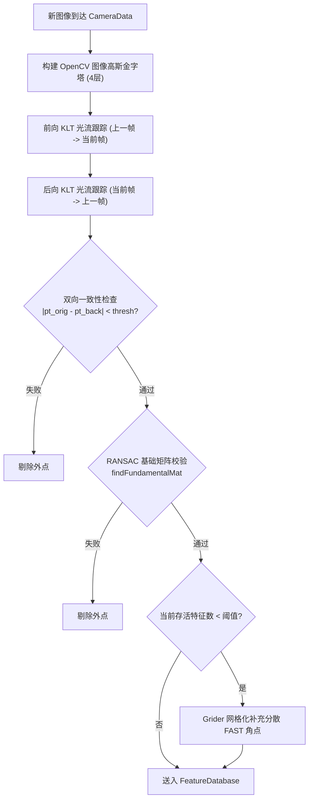
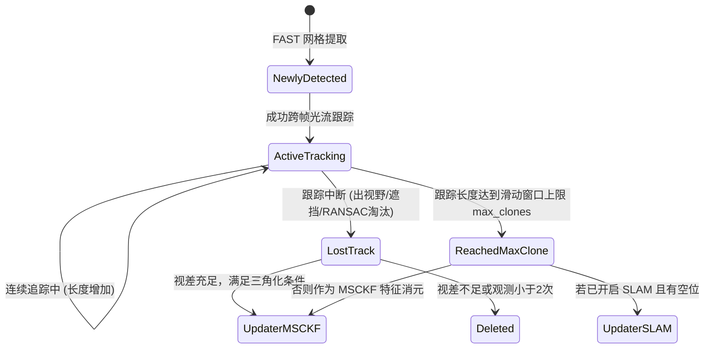

# 03. 相机模型与视觉前端工程实现 (Camera Models & Frontend Tracking)

视觉前端（Visual Frontend）负责从高帧率图像序列中实时提取高质量特征点，并维持时空连续的数据关联（Data Association）。前端输出的特征轨迹质量与精度，直接决定了后端滤波器的收敛性与稳定性。

本章系统梳理相机几何成像与畸变数学模型（Radtan 与 Equi）、前端特征提取与 KLT 金字塔光流追踪、立体匹配、异常点几何剔除，以及特征数据库（FeatureDatabase）的生命周期管理。

---

## 1. 相机几何投影与畸变数学模型

设三维特征点在相机坐标系 $\{C\}$ 下的坐标为 ${}^C\mathbf{p} = [X, Y, Z]^\top$（$Z > 0$）。相机成像过程分为两步：
1. **透视投影到归一化平面**；
2. **非线性畸变与像素坐标映射**。

```
    3D 空间点 P(X,Y,Z)
           |
           v (透视投影 Perspective Projection)
    归一化平面坐标 [u_n, v_n]^T = [X/Z, Y/Z]^T
           |
           v (非线性畸变 Distortion Model: Radtan / Equi)
    畸变归一化坐标 [u_d, v_d]^T
           |
           v (内参焦距主点映射 Intrinsic Affine)
    最终像素坐标 [u, v]^T
```

### 1.1 归一化透视投影及其雅可比

空间点 ${}^C\mathbf{p}$ 投影到归一化图像平面（$Z = 1$）上的无畸变物理坐标为：
$$
\mathbf{z}_n = \begin{bmatrix} u_n \\ v_n \end{bmatrix} = \begin{bmatrix} X / Z \\ Y / Z \end{bmatrix}
$$
归一化坐标关于空间点 ${}^C\mathbf{p}$ 的一阶导数雅可比矩阵为：
$$
\frac{\partial \mathbf{z}_n}{\partial {}^C\mathbf{p}} = \begin{bmatrix}
\frac{1}{Z} & 0 & -\frac{X}{Z^2} \\
0 & \frac{1}{Z} & -\frac{Y}{Z^2}
\end{bmatrix} \in \mathbb{R}^{2\times 3}
$$
> **源码对照**：参见 [ov_msckf/src/update/UpdaterHelper.cpp](../ov_msckf/src/update/UpdaterHelper.cpp#L365-L372)：
> ```cpp
> dzn_dpfc << 1 / p_FinCi(2), 0, -p_FinCi(0) / (p_FinCi(2) * p_FinCi(2)), 
>             0, 1 / p_FinCi(2), -p_FinCi(1) / (p_FinCi(2) * p_FinCi(2));
> ```

---

### 1.2 Brown-Conrady 径向畸变与切向畸变模型 (Radtan)

针对于普通视场角（FOV < 100°）镜头，OpenVINS 采用经典的 Brown-Conrady 畸变模型（Kalibr 标定工具常用的 `radtan` 模型）。

相机内参向量定义为：
$$
\boldsymbol{\zeta}_{radtan} = \begin{bmatrix} f_x & f_y & c_x & c_y & k_1 & k_2 & p_1 & p_2 \end{bmatrix}^\top
$$
其中 $f_x, f_y$ 为焦距，$c_x, c_y$ 为主点中心偏移；$k_1, k_2$ 为径向畸变系数；$p_1, p_2$ 为切向畸变系数。

#### 正向畸变投影公式
定义归一化半径平方 $r^2 = u_n^2 + v_n^2$：
1. 径向畸变因子：$D_r = 1 + k_1 r^2 + k_2 r^4$；
2. 切向畸变补偿：
   $$
   \begin{aligned}
   \Delta u &= 2 p_1 u_n v_n + p_2 (r^2 + 2 u_n^2) \\
   \Delta v &= p_1 (r^2 + 2 v_n^2) + 2 p_2 u_n v_n
   \end{aligned}
   $$
3. 畸变后归一化坐标：
   $$
   \mathbf{z}_d = \begin{bmatrix} u_d \\ v_d \end{bmatrix} = \begin{bmatrix} u_n D_r + \Delta u \\ v_n D_r + \Delta v \end{bmatrix}
   $$
4. 映射到最终像素平面：
   $$
   \mathbf{z} = \begin{bmatrix} u \\ v \end{bmatrix} = \begin{bmatrix} f_x u_d + c_x \\ f_y v_d + c_y \end{bmatrix}
   $$

#### 畸变雅可比矩阵 $\frac{\partial \mathbf{z}}{\partial \mathbf{z}_n}$
根据多元微积分链式求导法则，像素测量 $\mathbf{z}$ 关于归一化坐标 $\mathbf{z}_n$ 的雅可比为：
$$
\frac{\partial \mathbf{z}}{\partial \mathbf{z}_n} = \begin{bmatrix} f_x & 0 \\ 0 & f_y \end{bmatrix} \begin{bmatrix} \frac{\partial u_d}{\partial u_n} & \frac{\partial u_d}{\partial v_n} \\ \frac{\partial v_d}{\partial u_n} & \frac{\partial v_d}{\partial v_n} \end{bmatrix}
$$
其中：
$$
\begin{aligned}
\frac{\partial u_d}{\partial u_n} &= D_r + 2 k_1 u_n^2 + 4 k_2 r^2 u_n^2 + 2 p_1 v_n + 6 p_2 u_n \\
\frac{\partial u_d}{\partial v_n} &= 2 k_1 u_n v_n + 4 k_2 r^2 u_n v_n + 2 p_1 u_n + 2 p_2 v_n \\
\frac{\partial v_d}{\partial u_n} &= \frac{\partial u_d}{\partial v_n} \\
\frac{\partial v_d}{\partial v_n} &= D_r + 2 k_1 v_n^2 + 4 k_2 r^2 v_n^2 + 6 p_1 v_n + 2 p_2 u_n
\end{aligned}
$$
> **源码对照**：详见 [ov_core/src/cam/CamRadtan.h](../ov_core/src/cam/CamRadtan.h) 中的 `compute_distort_jacobian` 方法。

---

### 1.3 Kannala-Brandt 等距鱼眼模型 (Equidistant / Equi)

针对超广角或鱼眼相机（FOV > 120°，如 EuRoC MAV、TUM-VI 数据集），透视投影会导致边缘像素严重拉伸甚至失效。OpenVINS 实现了 Kannala-Brandt 等距模型（`equi`）。

内参向量定义为：
$$
\boldsymbol{\zeta}_{equi} = \begin{bmatrix} f_x & f_y & c_x & c_y & k_1 & k_2 & k_3 & k_4 \end{bmatrix}^\top
$$
入射角与投影几何模型：
1. 入射光线与光轴夹角：$\theta = \arctan(r) = \arctan\left(\sqrt{u_n^2 + v_n^2}\right)$；
2. 畸变入射角多项式展开：
   $$
   \theta_d = \theta \left( 1 + k_1 \theta^2 + k_2 \theta^4 + k_3 \theta^6 + k_4 \theta^8 \right)
   $$
3. 畸变归一化坐标：
   $$
   \begin{bmatrix} u_d \\ v_d \end{bmatrix} = \frac{\theta_d}{r} \begin{bmatrix} u_n \\ v_n \end{bmatrix}
   $$
4. 像素映射：
   $$
   \mathbf{z} = \begin{bmatrix} f_x u_d + c_x \\ f_y v_d + c_y \end{bmatrix}
   $$

> **源码对照**：详见 [ov_core/src/cam/CamEqui.h](../ov_core/src/cam/CamEqui.h)。

---

## 2. 视觉前端特征提取与跟踪流水线

OpenVINS 的前端追踪模块主要由 `TrackKLT`（光流追踪）和 `Grider_FAST`（网格化提取）实现。



### 2.1 网格化均匀特征提取 (`Grider_FAST`)
如果直接在全图上使用全局 FAST 或 Shi-Tomasi 提取角点，特征往往高度堆积在局部高频纹理区域（例如树叶、地毯），而空旷平坦区域缺乏特征。这会导致：
- 视觉约束基线退化；
- 相机旋转/平移的可观测性严重受损。

OpenVINS 采用网格划分策略（Grid Distribution）：
- 将图像按行、列划分为 $M \times N$ 个网格（如配置文件中配置的 `grid_x: 5, grid_y: 5`）；
- 统计每个网格内已有历史跟踪特征的数量；
- 仅在特征数量不足的网格单元内触发 `cv::FAST` 角点提取；
- 施加局部非极大值抑制（NMS）及最小特征间距约束（`min_px_dist: 10` 像素）。
> **源码对照**：详见 [ov_core/src/track/Grider_FAST.h](../ov_core/src/track/Grider_FAST.h)。

### 2.2 双向金字塔 KLT 光流跟踪与多重几何检验

文件路径：[ov_core/src/track/TrackKLT.cpp](../ov_core/src/track/TrackKLT.cpp)
1. **多层图像金字塔构建**：默认构建 3~4 层金字塔，自顶向下逐层求解 Lucas-Kanade 光流方程，从而容忍大视差和快速运动。
2. **前向-反向一致性验证 (Forward-Backward Tracking Consistency)**：
   - 先从上一时刻图像 $I_{t-1}$ 前向跟踪特征到当前图像 $I_t$，获得预测点 $\hat{\mathbf{p}}_t$；
   - 再将 $\hat{\mathbf{p}}_t$ 反向跟踪回 $I_{t-1}$，获得落点 $\hat{\mathbf{p}}_{t-1}'$；
   - 计算欧氏几何反向误差：$\|\mathbf{p}_{t-1} - \hat{\mathbf{p}}_{t-1}'\|_2$。若大于设定的阈值（通常 0.5~1.0 像素），则直接判定为跟踪丢失并剔除。
3. **基于 RANSAC 的对极几何基础矩阵过滤 (RANSAC Epipolar Gating)**：
   - 利用 `cv::findFundamentalMat(..., cv::FM_RANSAC, 1.0, 0.99)` 检验前后两帧的所有匹配对；
   - 剔除动态运动物体（如行人、过往车辆）引起的非刚体运动外点。

### 2.3 双目立体匹配 (Stereo Tracking)
当系统配置为双目模式时（`use_stereo: true`）：
- 左右两目相机在当前时刻曝光同步；
- 利用左目特征点直接沿极线（或金字塔光流）在右目图像上寻找对应匹配；
- 同时维护时间维度的轨迹（跨帧）与空间维度的双目约束（同帧）。

---

## 3. 特征管理数据库 (`FeatureDatabase`) 与生命周期流转

前端跟踪产生的观测数据全部汇聚到 `FeatureDatabase` 统一管理。



### 3.1 核心数据结构解析
文件路径：[ov_core/src/feat/Feature.h](../ov_core/src/feat/Feature.h) 与 [FeatureDatabase.h](../ov_core/src/feat/FeatureDatabase.h)

- `ov_core::Feature`：
  - `size_t featid`：全局唯一特征 ID；
  - `std::unordered_map<size_t, std::vector<double>> timestamps`：记录该特征在各相机中被观测到的时间戳列表（以相机 ID 为键）；
  - `std::unordered_map<size_t, std::vector<Eigen::VectorXf>> uvs`：对应的原始像素坐标 $[u, v]^\top$；
  - `std::unordered_map<size_t, std::vector<Eigen::VectorXf>> uvs_norm`：去畸变后的归一化图像平面坐标 $[u_n, v_n]^\top$；
  - `Eigen::Vector3d p_FinG`：特征点在全局系下的三维三角化坐标；
  - `Eigen::Vector3d p_FinA`：特征点在锚定克隆相机坐标系下的三维三角化坐标。

### 3.2 特征向后端更新器的分流决策

在 [ov_msckf/src/core/VioManager.cpp](../ov_msckf/src/core/VioManager.cpp#L350-L420) 的 `do_feature_propagate_update` 中：
1. **提取丢失特征 (`feats_lost`)**：在当前最新图像帧中未能继续被跟踪的特征；
2. **提取滑动窗口移出特征 (`feats_marg`)**：当前活跃追踪虽然还在继续，但其最早的观测时刻即将随最老克隆位姿被边缘化的特征；
3. **超长轨迹晋升为 SLAM 特征 (`feats_maxtracks`)**：
   - 若跟踪长度超过 `max_clone_size`，且系统开启了 SLAM 特征机制（`max_slam > 0`），则优先保留并注入到 SLAM 状态中；
4. **其余特征打包送入 MSCKF 更新器**：执行零空间投影消元，提取其对滑动窗口内所有位姿的几何约束后，立即从数据库中安全删除。
