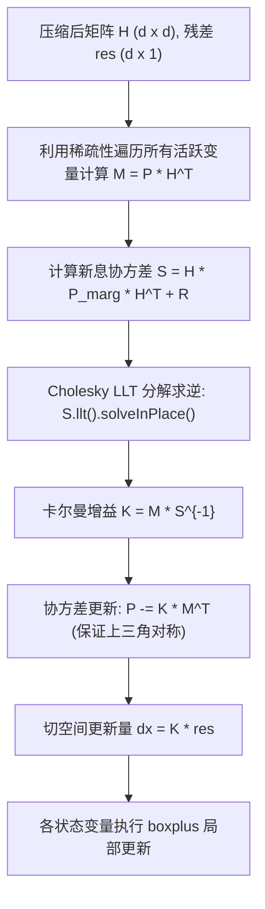

# 04. MSCKF 更新数学推导与工程实现 (MSCKF Update Theory & Implementation)

多状态约束卡尔曼滤波器（Multi-State Constraint Kalman Filter, MSCKF）由 Mourikis 和 Roumeliotis 于 2007 年提出，是现代轻量级紧耦合 VIO 算法的奠基之作。

传统 EKF-SLAM 将环境中的三维路标点坐标直接放入状态向量，导致状态维度随地图特征数线性增长，协方差矩阵求逆更新的计算复杂度高达 $\mathcal{O}(M^3)$，无法在边缘算力平台上持久运行。MSCKF 的革命性创新在于：**状态向量中仅维护一个有限长度滑动窗口内的相机历史克隆位姿；当某个特征点跟踪丢失或移出视口时，通过构造几何左零空间投影矩阵，将特征点坐标从观测方程中严格消除，从而在不估计特征点协方差的前提下，提取该特征点对滑动窗口内所有位姿的全部相互约束！**

本章从随机克隆开始，详尽推导特征三角化、零空间投影消元、QR 测量压缩、卡方外点剔除，直到 EKF 协方差更新，并深入源码行级实现。

---

## 1. 随机克隆 (Stochastic Cloning) 与协方差扩增

当新的图像帧在 $t_k$ 时刻到达且 IMU 积分完成时，必须将当前 IMU 坐标系位姿“克隆”到滑动窗口状态中。

```
时间流向 --->
[t_0] ------- [t_1] ------- ... ------- [t_k-1] ------- [t_k] (最新帧)
 Clone_0      Clone_1                   Clone_k-1       Active IMU -> 触发克隆 Clone_k
```

### 1.1 状态扩增与变换雅可比

设系统在克隆前的状态向量为 $\mathbf{x}$，对应的误差状态为 $\tilde{\mathbf{x}}$，当前活跃 IMU 位姿切空间误差为 $\tilde{\mathbf{x}}_{pose} = [{}^I_G\delta\boldsymbol{\theta}^\top, {}^G\tilde{\mathbf{p}}_I^\top]^\top \in \mathbb{R}^6$。
扩增后的新误差状态向量为：
$$
\tilde{\mathbf{x}}_{aug} = \begin{bmatrix} \tilde{\mathbf{x}} \\ \tilde{\mathbf{x}}_{clone} \end{bmatrix} = \mathbf{J}_{aug} \tilde{\mathbf{x}}
$$
其中克隆位姿直接复制自当前 IMU 位姿，因此雅可比矩阵为：
$$
\mathbf{J}_{aug} = \begin{bmatrix} \mathbf{I}_{D} \\ \mathbf{J}_c \end{bmatrix}, \quad \mathbf{J}_c = \begin{bmatrix} \mathbf{0}_{6 \times id} & \mathbf{I}_6 & \mathbf{0}_{6 \times (D - id - 6)} \end{bmatrix}
$$
根据不确定度传递定律，扩增后的协方差矩阵为：
$$
\mathbf{P}_{aug} = \mathbf{J}_{aug} \mathbf{P} \mathbf{J}_{aug}^\top = \begin{bmatrix}
\mathbf{P} & \mathbf{P} \mathbf{J}_c^\top \\
\mathbf{J}_c \mathbf{P} & \mathbf{J}_c \mathbf{P} \mathbf{J}_c^\top
\end{bmatrix}
$$
物理意义：
- 右下角子块 $\mathbf{J}_c \mathbf{P} \mathbf{J}_c^\top = \mathbf{P}_{pose, pose}$（克隆位姿自协方差等于当前 IMU 位姿自协方差）；
- 交叉项 $\mathbf{P} \mathbf{J}_c^\top = \mathbf{P}_{*, pose}$（克隆位姿继承当前 IMU 位姿与系统中所有其他变量的全部互相关项）。

### 1.2 时间偏移 $t_d$ 扰动修正

若开启相机-IMU 时间偏移在线估计（`calib_cam_timeoffset: true`），图像真实曝光时刻在 IMU 时钟下为 $t_{imu} = t_{cam} + t_d$。小时间偏移误差 $\tilde{t}_d$ 会通过运动学直接耦合到位姿克隆中（Li & Mourikis, IJRR 2014）：
$$
\begin{aligned}
{}^{I_{t+t_d}}_G\bar{q} &\simeq \begin{bmatrix} \frac{1}{2}{}^I\boldsymbol{\omega} \tilde{t}_d \\ 1 \end{bmatrix} \otimes {}^{I_{t+\hat{t}_d}}_G\hat{\bar{q}} \\
{}^G\mathbf{p}_{I_{t+t_d}} &\simeq {}^G\hat{\mathbf{p}}_{I_{t+\hat{t}_d}} + {}^G\hat{\mathbf{v}}_{I_{t+\hat{t}_d}} \tilde{t}_d
\end{aligned}
$$
其关于时间偏移误差 $\tilde{t}_d$ 的导数为：
$$
\frac{\partial \tilde{\mathbf{x}}_{clone}}{\partial \tilde{t}_d} = \begin{bmatrix} {}^I\boldsymbol{\omega} \\ {}^G\mathbf{v}_I \end{bmatrix} \in \mathbb{R}^{6\times 1}
$$
> **源码对照**：参见 [ov_msckf/src/state/StateHelper.cpp](../ov_msckf/src/state/StateHelper.cpp#L604-L616) 的 `augment_clone` 函数：
> ```cpp
> Eigen::Matrix<double, 6, 1> dnc_dt = Eigen::MatrixXd::Zero(6, 1);
> dnc_dt.block(0, 0, 3, 1) = last_w;
> dnc_dt.block(3, 0, 3, 1) = state->_imu->vel();
> state->_Cov.block(0, pose->id(), state->_Cov.rows(), 6) +=
>     state->_Cov.block(0, state->_calib_dt_CAMtoIMU->id(), state->_Cov.rows(), 1) * dnc_dt.transpose();
> state->_Cov.block(pose->id(), 0, 6, state->_Cov.rows()) +=
>     dnc_dt * state->_Cov.block(state->_calib_dt_CAMtoIMU->id(), 0, 1, state->_Cov.rows());
> ```

---

## 2. 特征点三角化与非线性重投影优化

在利用特征更新滤波器之前，必须获得其三维空间坐标（用于构建线性化点展开）。

### 2.1 线性 SVD 三角化 (DLT)
对于某个特征点，其在多个克隆相机位姿下具有像素测量集合 $\{ \mathbf{z}_j \}$，反畸变后得到归一化坐标 $\mathbf{x}_{n, j} = [u_{n, j}, v_{n, j}, 1]^\top$。
在第 $j$ 帧相机系下，投影关系满足对极几何叉积约束：
$$
\mathbf{x}_{n, j} \times \left( {}^C_G\mathbf{R}_j {}^G\mathbf{p}_f + {}^C\mathbf{p}_{G, j} \right) = \mathbf{0}
$$
展开写成代数方程 $\mathbf{A}_j {}^G\mathbf{p}_f = \mathbf{b}_j$。堆叠所有观测构建超定方程组 $\mathbf{A} {}^G\mathbf{p}_f = \mathbf{b}$，利用奇异值分解（SVD）求解最小二乘闭式解。

### 2.2 Gauss-Newton 非线性重投影误差精化
由于图像噪声存在，线性三角化解并非最优估计。OpenVINS 进一步以线性解为初值，执行轻量级 Gauss-Newton 迭代优化（通常 2~3 次迭代即可收敛）：
$$
{}^G\mathbf{p}_f^* = \arg\min_{{}^G\mathbf{p}_f} \sum_{j} \rho\left( \left\| \mathbf{z}_j - \mathbf{h}_j({}^G\mathbf{p}_f) \right\|_{\mathbf{R}_j}^2 \right)
$$
其中采用 Huber 鲁棒核函数 $\rho(\cdot)$ 抑制误匹配外点的影响。若优化后重投影误差过大或深度为负（位于相机后方），则直接判定为三角化失败并丢弃该特征。
> **源码对照**：详见 [ov_core/src/feat/FeatureInitializer.cpp](../ov_core/src/feat/FeatureInitializer.cpp) 的 `single_triangulation` 与 `single_gaussnewton`。

---

## 3. 视觉测量方程与全雅可比矩阵构建

设静态路标点在全局系下的三维坐标为 ${}^G\mathbf{p}_f$。在第 $j$ 个克隆相机系下的理论像素投影方程为：
$$
\mathbf{z}_{i, j} = \mathbf{h}\left( {}^I_G\mathbf{q}_j, {}^G\mathbf{p}_{I_j}, {}^C_I\mathbf{q}, {}^I\mathbf{p}_C, {}^G\mathbf{p}_f \right) + \mathbf{n}_{i, j}
$$
在当前线性化点处进行一阶 Taylor 展开：
$$
\tilde{\mathbf{z}}_{i, j} = \mathbf{z}_{i, j} - \hat{\mathbf{z}}_{i, j} \approx \mathbf{H}_{x, i, j} \tilde{\mathbf{x}} + \mathbf{H}_{f, i, j} \tilde{\mathbf{p}}_f + \mathbf{n}_{i, j}
$$
其中：
- $\mathbf{H}_{x, i, j}$ 为测量残差关于系统误差状态（克隆位姿、外参、内参）的雅可比矩阵；
- $\mathbf{H}_{f, i, j}$ 为测量残差关于路标三维位置误差 $\tilde{\mathbf{p}}_f$ 的雅可比矩阵；
- $\mathbf{n}_{i, j} \sim \mathcal{N}(\mathbf{0}, \sigma_{pix}^2 \mathbf{I}_2)$ 为像素各向同性高斯白噪声。

### 雅可比链式推导
根据成像几何复合求导：
$$
\mathbf{H}_{x, i, j} = \frac{\partial \mathbf{z}}{\partial \mathbf{z}_n} \cdot \frac{\partial \mathbf{z}_n}{\partial {}^C\mathbf{p}} \cdot \frac{\partial {}^C\mathbf{p}}{\partial \mathbf{x}}, \quad \mathbf{H}_{f, i, j} = \frac{\partial \mathbf{z}}{\partial \mathbf{z}_n} \cdot \frac{\partial \mathbf{z}_n}{\partial {}^C\mathbf{p}} \cdot \frac{\partial {}^C\mathbf{p}}{\partial {}^G\mathbf{p}_f}
$$
令中间投影增益矩阵为 $\mathbf{J}_{proj} = \frac{\partial \mathbf{z}}{\partial \mathbf{z}_n} \frac{\partial \mathbf{z}_n}{\partial {}^C\mathbf{p}} \in \mathbb{R}^{2\times 3}$：
1. **关于路标三维位置的雅可比 $\mathbf{H}_{f}$**：
   $$
   \mathbf{H}_{f, i, j} = \mathbf{J}_{proj} \cdot {}^C_I\mathbf{R} \cdot {}^I_G\mathbf{R}_j \in \mathbb{R}^{2\times 3}
   $$
2. **关于克隆位姿误差的雅可比 $\mathbf{H}_{clone}$**：
   空间点在当前相机系下为 ${}^C\mathbf{p}_j = {}^C_I\mathbf{R} \cdot {}^I_G\mathbf{R}_j ({}^G\mathbf{p}_f - {}^G\mathbf{p}_{I_j}) + {}^C\mathbf{p}_I$：
   - 关于姿态误差 ${}^I\delta\boldsymbol{\theta}_j$：
     $$
     \frac{\partial {}^C\mathbf{p}_j}{\partial {}^I\delta\boldsymbol{\theta}_j} = {}^C_I\mathbf{R} \lfloor {}^I\mathbf{p}_{f, j} \times \rfloor
     $$
   - 关于位置误差 ${}^G\tilde{\mathbf{p}}_{I_j}$：
     $$
     \frac{\partial {}^C\mathbf{p}_j}{\partial {}^G\tilde{\mathbf{p}}_{I_j}} = -{}^C_I\mathbf{R} \cdot {}^I_G\mathbf{R}_j
     $$
   因此：
   $$
   \mathbf{H}_{clone, i, j} = \mathbf{J}_{proj} \begin{bmatrix} {}^C_I\mathbf{R} \lfloor {}^I\mathbf{p}_{f, j} \times \rfloor & -{}^C_I\mathbf{R} \cdot {}^I_G\mathbf{R}_j \end{bmatrix} \in \mathbb{R}^{2\times 6}
   $$

堆叠该特征在所有观测相机与历史时刻的 $M$ 次观测，得到特征整体的线性化观测方程组：
$$
\tilde{\mathbf{z}} \approx \mathbf{H}_x \tilde{\mathbf{x}} + \mathbf{H}_f \tilde{\mathbf{p}}_f + \mathbf{n}, \quad \tilde{\mathbf{z}} \in \mathbb{R}^{2M}, \; \mathbf{H}_f \in \mathbb{R}^{2M \times 3}, \; \mathbf{n} \sim \mathcal{N}(\mathbf{0}, \sigma_{pix}^2 \mathbf{I}_{2M})
$$

---

## 4. Givens 旋转左零空间投影 (Nullspace Projection)

观测方程中含有未知量 $\tilde{\mathbf{p}}_f$。为消除它，需寻找一个矩阵 $\mathbf{V}^\top$，使得：
$$
\mathbf{V}^\top \mathbf{H}_f = \mathbf{0}
$$
两边左乘 $\mathbf{V}^\top$ 后即可将路标误差项完全消除：
$$
\mathbf{r}_o = \mathbf{V}^\top \tilde{\mathbf{z}} = \mathbf{V}^\top \mathbf{H}_x \tilde{\mathbf{x}} + \mathbf{V}^\top \mathbf{H}_f \tilde{\mathbf{p}}_f + \mathbf{V}^\top \mathbf{n} = \mathbf{H}_o \tilde{\mathbf{x}} + \mathbf{n}_o
$$

### 4.1 正交投影矩阵的构造与各向同性噪声保持
对矩阵 $\mathbf{H}_f \in \mathbb{R}^{2M \times 3}$ 进行 QR 分解：
$$
\mathbf{H}_f = \mathbf{Q} \begin{bmatrix} \mathbf{R}_f \\ \mathbf{0} \end{bmatrix} = \begin{bmatrix} \mathbf{Q}_1 & \mathbf{Q}_2 \end{bmatrix} \begin{bmatrix} \mathbf{R}_f \\ \mathbf{0} \end{bmatrix}
$$
其中 $\mathbf{Q}_1 \in \mathbb{R}^{2M \times 3}$，$\mathbf{Q}_2 \in \mathbb{R}^{2M \times (2M - 3)}$。由于正交矩阵各列彼此正交，显然：
$$
\mathbf{Q}_2^\top \mathbf{H}_f = \mathbf{0}
$$
取 $\mathbf{V}^\top = \mathbf{Q}_2^\top$ 作为左零空间基底！

更为关键的是投影后的噪声协方差：
$$
\mathbf{R}_o = \mathbb{E}\left[ \mathbf{n}_o \mathbf{n}_o^\top \right] = \mathbf{V}^\top \mathbb{E}[\mathbf{n} \mathbf{n}^\top] \mathbf{V} = \mathbf{V}^\top (\sigma_{pix}^2 \mathbf{I}_{2M}) \mathbf{V} = \sigma_{pix}^2 \mathbf{V}^\top \mathbf{V}
$$
由于 $\mathbf{V} = \mathbf{Q}_2$ 且 $\mathbf{Q}$ 为标准正交矩阵，满足 $\mathbf{Q}_2^\top \mathbf{Q}_2 = \mathbf{I}_{(2M - 3)}$，因此：
$$
\mathbf{R}_o = \sigma_{pix}^2 \mathbf{I}_{(2M - 3)}
$$
**投影后的新测量噪声仍然严格保持为完全对角的各向同性白噪声！这避免了耗时的测量协方差求逆操作！**

### 4.2 Givens 旋转原地消元算法实现
在工程代码中，直接调用稠密 Householder QR 分解会导致频繁的堆内存分配与数据拷贝。OpenVINS 采用经典数值代数（Golomb & Van Loan, 4th Edition, Algorithm 5.2.4）的 **Givens 平面旋转（Jacobi Rotation）** 进行原地（In-place）消元。

Givens 矩阵通过平面正交旋转消去目标标量：
$$
\begin{bmatrix} c & s \\ -s & c \end{bmatrix} \begin{bmatrix} a \\ b \end{bmatrix} = \begin{bmatrix} r \\ 0 \end{bmatrix}
$$
> **源码对照**：打开 [ov_msckf/src/update/UpdaterHelper.cpp](../ov_msckf/src/update/UpdaterHelper.cpp#L420-L450) 中的 `nullspace_project_inplace`：
> ```cpp
> Eigen::JacobiRotation<double> tempHo_GR;
> for (int n = 0; n < H_f.cols(); ++n) {
>   for (int m = (int)H_f.rows() - 1; m > n; m--) {
>     // 构建消去 H_f(m, n) 的 Givens 矩阵
>     tempHo_GR.makeGivens(H_f(m - 1, n), H_f(m, n));
>     // 同步左乘变换到 H_f, H_x 与 res
>     (H_f.block(m - 1, n, 2, H_f.cols() - n)).applyOnTheLeft(0, 1, tempHo_GR.adjoint());
>     (H_x.block(m - 1, 0, 2, H_x.cols())).applyOnTheLeft(0, 1, tempHo_GR.adjoint());
>     (res.block(m - 1, 0, 2, 1)).applyOnTheLeft(0, 1, tempHo_GR.adjoint());
>   }
> }
> // 截取第 cols 行之后的零空间子块
> H_x = H_x.block(H_f.cols(), 0, H_x.rows() - H_f.cols(), H_x.cols()).eval();
> res = res.block(H_f.cols(), 0, res.rows() - H_f.cols(), res.cols()).eval();
> ```

---

## 5. 马氏距离卡方门限滤波 (Chi-Squared Outlier Rejection)

在将特征投影后的测量纳入系统大矩阵之前，必须进行卡方检验（$\chi^2$ Test），剔除误匹配引起的野值残差。

### 5.1 检验统计量构造
投影后的残差为 $\mathbf{r}_o$，其对应的理论新息协方差为：
$$
\mathbf{S} = \mathbf{H}_o \mathbf{P}_{marg} \mathbf{H}_o^\top + \sigma_{pix}^2 \mathbf{I}
$$
其中 $\mathbf{P}_{marg}$ 为仅涉及该特征观测位姿的较小边际协方差（由 `StateHelper::get_marginal_covariance` 提取）。

定义马氏距离统计量：
$$
\gamma = \mathbf{r}_o^\top \mathbf{S}^{-1} \mathbf{r}_o
$$
利用 LLT Cholesky 分解高效求解线性方程 $\mathbf{S} \mathbf{y} = \mathbf{r}_o$，则 $\gamma = \mathbf{r}_o^\top \mathbf{y}$。

### 5.2 自由度与置信度门限判定
统计量 $\gamma$ 服从自由度为 $k = \dim(\mathbf{r}_o) = 2M - 3$ 的卡方分布：
$$
\gamma \sim \chi^2(k)
$$
OpenVINS 预计算了 95% 置信度下的卡方分位数表 `chi_squared_table`：
- 若 $\gamma \le \text{chi2\_multipler} \times \chi^2_{0.95}(k)$，判定为有效内点，保留并堆叠；
- 否则判定为异常外点，直接剔除，避免污染滤波器状态。
> **源码对照**：见 [ov_msckf/src/update/UpdaterMSCKF.cpp](../ov_msckf/src/update/UpdaterMSCKF.cpp#L210-L245)。

---

## 6. QR 测量压缩 (Measurement Compression)

经过零空间投影和卡方检验后，可能有数十个有效特征被堆叠。设总测量行数为 $M_{total}$（可能高达 $1000 \sim 3000$ 维），而涉及的状态变量切空间总维度为 $d$（通常 $6 \times 11 + 15 \approx 81$ 维）。
由于 $M_{total} \gg d$，直接对系统求卡尔曼增益 $\mathbf{K} = \mathbf{P} \mathbf{H}^\top (\mathbf{H} \mathbf{P} \mathbf{H}^\top + \mathbf{R})^{-1}$ 需要对 $M_{total} \times M_{total}$ 的大矩阵求逆，计算量无法接受！

### 测量压缩原理
对堆叠后的大观测方程 $\mathbf{r}_{big} = \mathbf{H}_{big} \tilde{\mathbf{x}} + \mathbf{n}_{big}$ 的系数矩阵 $\mathbf{H}_{big} \in \mathbb{R}^{M_{total} \times d}$ 进行 QR 分解：
$$
\mathbf{H}_{big} = \begin{bmatrix} \mathbf{Q}_{c1} & \mathbf{Q}_{c2} \end{bmatrix} \begin{bmatrix} \mathbf{T}_H \\ \mathbf{0} \end{bmatrix}
$$
其中 $\mathbf{T}_H \in \mathbb{R}^{d \times d}$ 为上三角矩阵。
两边左乘 $\mathbf{Q}_{c1}^\top$：
$$
\mathbf{r}_m = \mathbf{Q}_{c1}^\top \mathbf{r}_{big} = \mathbf{T}_H \tilde{\mathbf{x}} + \mathbf{n}_m
$$
此时：
- 新观测矩阵行数从 $M_{total}$ 骤降到 $d$（不超过状态维度！）；
- 由于 $\mathbf{Q}_{c1}$ 具有标准正交列，新测量噪声协方差依然完美保持为 $\sigma_{pix}^2 \mathbf{I}_d$！
- 矩阵求逆维度从数千维瞬间缩减为数十维，算法提速数十倍！
> **源码对照**：详见 [ov_msckf/src/update/UpdaterHelper.cpp](../ov_msckf/src/update/UpdaterHelper.cpp#L450-L485) 中的 `measurement_compress_inplace`。

---

## 7. EKF 状态与协方差高效更新 (`StateHelper::EKFUpdate`)

完成测量压缩后，调用 `StateHelper::EKFUpdate` 实施最终的卡尔曼更新。



### 7.1 稀疏矩阵加速计算 $M = \mathbf{P} \mathbf{H}^\top$
大协方差矩阵 $\mathbf{P}$ 包含系统中所有状态，而当前观测矩阵 $\mathbf{H}$ 仅在涉及到的克隆位姿与外参列上非零。
在 [ov_msckf/src/state/StateHelper.cpp](../ov_msckf/src/state/StateHelper.cpp#L136-L146) 中：
```cpp
for (const auto &var : state->_variables) {
  Eigen::MatrixXd M_i = Eigen::MatrixXd::Zero(var->size(), res.rows());
  for (size_t i = 0; i < H_order.size(); i++) {
    std::shared_ptr<Type> meas_var = H_order[i];
    M_i.noalias() += state->_Cov.block(var->id(), meas_var->id(), var->size(), meas_var->size()) *
                     H.block(0, H_id[i], H.rows(), meas_var->size()).transpose();
  }
  M_a.block(var->id(), 0, var->size(), res.rows()) = M_i;
}
```
通过遍历测量变量子块累加，避免了全尺寸大矩阵稠密相乘。

### 7.2 协方差削减与数值正定性保护
标准协方差更新公式为 $\mathbf{P} \leftarrow \mathbf{P} - \mathbf{K} \mathbf{H} \mathbf{P} = \mathbf{P} - \mathbf{K} \mathbf{M}^\top$。
OpenVINS 仅更新上三角部分并强制对称：
```cpp
state->_Cov.triangularView<Eigen::Upper>() -= K * M_a.transpose();
state->_Cov = state->_Cov.selfadjointView<Eigen::Upper>();
```
并在更新后检查对角线元素非负性，防止数值截断误差导致滤波器方差崩溃发散。

### 7.3 切空间误差增量回填
计算完整切空间校正向量：
$$
\Delta\mathbf{x} = \mathbf{K} \mathbf{r}
$$
遍历所有注册变量，调用其虚函数 `update(dx)`，在李流形切空间上完成物理状态修正（$\boxplus$）。
更新完毕后，最老的历史克隆位姿通过 `marginalize_old_clone` 从协方差矩阵中剔除，滑动窗口平稳向前推进。
