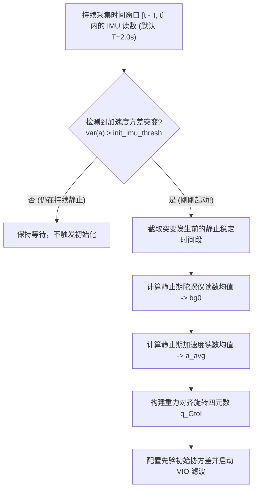
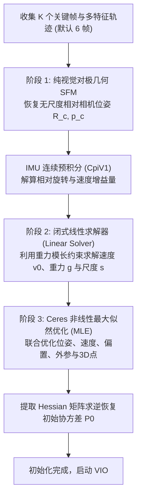

# 06. 系统初始化机制 (System Initialization)

初始化是视觉惯性里程计（VIO）系统最核心的生命起点。由于 VIO 系统本身存在高度非线性以及未观测的重力对齐未知量，若在未充分初始化的状态下直接盲目开启非线性滤波或图优化，系统极易陷入局部伪极小值或直接发散崩溃。

OpenVINS 提供了两套完备的初始化方案：
1. **静态初始化 (`StaticInitializer`)**：假设系统由静止状态起动，算法极轻量、速度极快、绝对鲁棒；
2. **动态初始化 (`DynamicInitializer`)**：支持载体在未知任意运动过程中的“空中即开即用（In-flight / Dynamic Init）”，基于闭式线性解初值与 Ceres 非线性最大似然估计（MLE）。

本章系统解析两种初始化方式的数学原理与源码实现。

---

## 1. VIO 初始化的本质任务与物理量求解

初始化必须准确恢复以下关键物理状态：
1. **重力对齐旋转矩阵 ${}^I\mathbf{R}_G$**：确定当前机体相对于全局重力矢量的绝对俯仰角（Pitch）与横滚角（Roll）（偏航角 Yaw 在没有磁力计或绝对定位时可任意设为 0）；
2. **真实三维线速度 ${}^G\mathbf{v}_I$**：静止时为 $\mathbf{0}$，动态初始化时需精准解算；
3. **传感器初始零偏 $\mathbf{b}_g, \mathbf{b}_a$**：尤其是陀螺仪偏置 $\mathbf{b}_g$，其细微误差会在初始角度积分中迅速发散；
4. **单目尺度因子 $s$（单目系统必须）**：将纯视觉无尺度几何投影约束缩放到真实米制尺度；
5. **系统初始协方差矩阵 $\mathbf{P}_0$**：为 EKF 滤波提供正定的不确定度先验。

---

## 2. 静态初始化机制 (`StaticInitializer`)

静态初始化通常适用于无人机起飞前、手持设备静止放置、地面车辆点火起步等场景。

### 2.1 运动突变检测算法 (Jerk / Variance Detection)
在现实操作中，用户往往是将设备静止放置一段时间后，拿起设备开始运动。
若在设备正在静止时就立刻初始化，用户拿起设备的瞬间剧烈加速度很容易引发冲击。OpenVINS 采用聪明的**滞后起动检测（Wait for Jerk）策略**：
1. 在滑动窗口（`init_window_time: 2.0s`）内持续监测加速度计方差：
   $$
   \operatorname{var}(\mathbf{a}) = \frac{1}{K}\sum_{k=1}^K \|\mathbf{a}_k - \bar{\mathbf{a}}\|^2
   $$
2. 当 $\operatorname{var}(\mathbf{a}) > \text{init\_imu\_thresh}$（默认 1.5 $\text{m/s}^2$）时，表明载体从静止状态刚刚开始被移动；
3. 算法倒退截取突变发生**之前**处于严格静止状态的稳定时间窗口作为最终初始化数据源！

### 2.2 重力向量提取与姿态对齐
在静止状态下，由于几何线加速度为零（${}^G\mathbf{a} = \mathbf{0}$），加速度计敏感到的唯有地心引力反作用力（比力）：
$$
\mathbf{a}_m \approx -{}^I\mathbf{R}_G {}^G\mathbf{g} + \mathbf{b}_a + \mathbf{w}_a
$$
忽略小微加速度零偏后，加速度计均值矢量为：
$$
\bar{\mathbf{a}} = \frac{1}{K}\sum_{k=1}^K \mathbf{a}_k \approx -{}^I\mathbf{R}_G \begin{bmatrix} 0 \\ 0 \\ -g \end{bmatrix} = {}^I\mathbf{R}_G \begin{bmatrix} 0 \\ 0 \\ g \end{bmatrix}
$$
设理想全局重力方向为 $\mathbf{g}_{ref} = [0, 0, 1]^\top$，测得的机体引力方向为 $\hat{\mathbf{a}} = \bar{\mathbf{a}} / \|\bar{\mathbf{a}}\|$。
构造旋转四元数 ${}^I\bar{q}_G$，使其满足：
$$
{}^I\mathbf{R}_G \mathbf{g}_{ref} = \hat{\mathbf{a}}
$$
通过两三维向量叉积求取旋转轴 $\mathbf{n} = \mathbf{g}_{ref} \times \hat{\mathbf{a}}$，点积求取旋转角 $\theta = \arccos(\mathbf{g}_{ref} \cdot \hat{\mathbf{a}})$，构建罗德里格斯四元数即可完成初始水平姿态对齐。

### 2.3 陀螺零偏均值估计
在静止期内角速度真值恒为零（$\boldsymbol{\omega}(t) = \mathbf{0}$），陀螺仪输出直接反映了当前环境温度下的零偏均值：
$$
\hat{\mathbf{b}}_g = \frac{1}{K}\sum_{k=1}^K \boldsymbol{\omega}_k
$$
初始线速度设为 ${}^G\mathbf{v}_I = [0, 0, 0]^\top$。
> **源码对照**：详见 [ov_init/src/static/StaticInitializer.cpp](../ov_init/src/static/StaticInitializer.cpp#L45-L110)。

---

## 3. 动态初始化机制 (`DynamicInitializer`)

当无人机在空中巡航丢锁重启、或者手持设备已在行走运动中启动时，静态假设完全失效。OpenVINS 实现了基于 Dong-Si & Mourikis (IROS 2012) 理论的高性能动态初始化流水线。

### 3.1 阶段 1：纯视觉 SFM 与连续预积分 (CPI)
1. 在滑动窗口内选取 $K$ 个具有足够视觉视差的关键图像帧（默认 6 帧，`init_dyn_num_pose: 6`，且要求累积姿态变化超过 `init_dyn_min_deg: 10.0°`）；
2. 利用 5 点法对极几何与本质矩阵分解，解算相机间的无尺度相对旋转矩阵与平移方向；
3. 对关键帧之间的 IMU 原始读数进行连续预积分（采用 `ov_core::CpiV1` 类），获得预积分观测量 $\Delta\mathbf{R}_{ij}, \Delta\mathbf{v}_{ij}, \Delta\mathbf{p}_{ij}$ 及其协方差。

### 3.2 阶段 2：闭式线性求解器 (Linear Closed-form Solver)
将视觉恢复的相对平移与 IMU 预积分位移方程联立：
$$
s \cdot {}^{C_i}\mathbf{p}_{C_j} = {}^C\mathbf{R}_I \left( {}^{I_j}\mathbf{R}_G \left( {}^G\mathbf{p}_i + {}^G\mathbf{v}_i \Delta t_{ij} + \frac{1}{2}{}^G\mathbf{g}\Delta t_{ij}^2 - {}^G\mathbf{p}_j \right) \right)
$$
式中待求解的未知量为：
- 单目未知尺度因子 $s$；
- 初始关键帧的三维绝对线速度 ${}^G\mathbf{v}_0$；
- 全局重力矢量 ${}^G\mathbf{g}$。

整理为超定线性方程组：
$$
\mathbf{A} \mathbf{x}_{lin} = \mathbf{b}, \quad \mathbf{x}_{lin} = \begin{bmatrix} s & {}^G\mathbf{v}_0^\top & {}^G\mathbf{g}^\top \end{bmatrix}^\top \in \mathbb{R}^7
$$
通过 Cholesky 分解或 SVD 求解最小二乘解，并显式引入物理先验约束：
$$
\|{}^G\mathbf{g}\| = 9.81 \, \text{m/s}^2
$$
通过检验方程矩阵的倒数条件数（`init_dyn_min_rec_cond`，通常门限 $10^{-12}$），若激励运动不充分（例如纯匀速直线平移导致重力方向不可观），算法拒绝初始化并等待更有利的机动动作。

### 3.3 阶段 3：Ceres 非线性最大似然优化 (MLE Refinement)
文件路径：[ov_init/src/ceres/](../ov_init/src/ceres/)
以线性闭式解为高质量初值，调用 Google Ceres-Solver 求解器构建滑动窗口内全局 Bundle Adjustment (BA) 最大似然估计：

目标损失函数为：
$$
\min_{\mathbf{X}} \left\{ \sum_{i, j, k} \left\| \mathbf{r}_{vis}(i, j, k) \right\|_{\mathbf{R}_{vis}}^2 + \sum_{i} \left\| \mathbf{r}_{imu}(i, i+1) \right\|_{\mathbf{Q}_{cpi}}^2 \right\}
$$
其中包含两大自定义 Ceres 优化残差因子：
1. **视觉重投影与标定因子 (`Factor_ImageReprojCalib.cpp`)**：
   计算 3D 特征点到各相机的重投影误差，并在优化中评估相机-IMU 外参导数；
2. **连续预积分因子 (`Factor_ImuCPIv1.cpp`)**：
   约束相邻关键帧间的位姿、速度与陀螺仪/加速度计零偏变动。

### 3.4 初始系统协方差恢复与膨胀 (Covariance Recovery & Inflation)
在 Ceres 优化收敛于全局最优解后，提取关于误差状态的稠密 Hessian 信息矩阵 $\boldsymbol{\Lambda} = \mathbf{J}^\top \boldsymbol{\Sigma}^{-1} \mathbf{J}$。
通过求逆提取状态的不确定度协方差：
$$
\mathbf{P}_0 = \boldsymbol{\Lambda}^{-1}
$$
由于初始化窗口有限，为防止初始协方差过于乐观导致后续滤波对新测量缺乏弹性，OpenVINS 对恢复的先验协方差施加**主动膨胀系数（Inflation Factors）**：
- 姿态方差膨胀：`init_dyn_inflation_ori: 10`
- 速度方差膨胀：`init_dyn_inflation_vel: 100`
- 陀螺偏置方差膨胀：`init_dyn_inflation_bg: 10`
- 加计偏置方差膨胀：`init_dyn_inflation_ba: 100`
膨胀后的正定协方差矩阵注入 `State` 中，VIO 系统实现无缝、平稳的在线起飞启动！
> **源码对照**：详见 [ov_init/src/dynamic/DynamicInitializer.cpp](../ov_init/src/dynamic/DynamicInitializer.cpp#L250-L360)。
