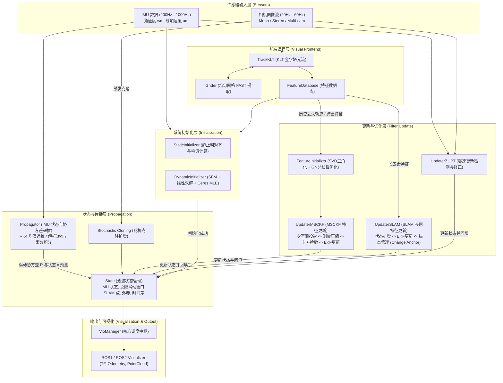

# OpenVINS 核心技术文档体系：数学原理、工程源码实现与实操调参指南

欢迎阅读 OpenVINS 全方位深度解析文档。本套文档旨在搭建理论推导与工程源码之间的桥梁，既涵盖视觉惯性里程计（VIO）领域严密的数学推导（基于 JPL 四元数流派、连续动力学、左零空间投影、第一估计雅可比 FEJ 等），又深入 OpenVINS 源码细节（行级对照、数据结构演化、矩阵运算优化），并提供工业级实战调参手册（无人机大机动、强振动、低纹理等工况）。

---

## 目录与文档导航

| 序号 | 文档名称 | 核心内容概述 |
|:---:|:---|:---|
| **00** | [README.md](./README.md) | 文档架构总览、OpenVINS 整体架构图解、数学符号约定体系 |
| **01** | [01_mathematics_and_state_representation.md](./01_mathematics_and_state_representation.md) | JPL 四元数理论推导（vs Hamilton）、李代数扰动模型、状态向量完整定义、误差状态切空间（$\boxplus/\boxminus$）、协方差矩阵存储机制及对应核心类解析 |
| **02** | [02_imu_propagation_and_preintegration.md](./02_imu_propagation_and_preintegration.md) | IMU 连续时间动力学推导、误差动力学方程、状态转移矩阵 $\boldsymbol{\Phi}$ 与离散噪声 $\mathbf{Q}_d$ 的解析/数值积分计算、RK4 均值递推、连续预积分 CPI（CPIv1 与 CPIv2）理论及 `Propagator` 类源码精读 |
| **03** | [03_camera_models_and_frontend_tracking.md](./03_camera_models_and_frontend_tracking.md) | 针孔模型、Brown-Conrady (Radtan) 与 Kannala-Brandt (Equidistant) 畸变模型及雅可比、FAST+网格化特征提取、KLT 金字塔光流跟踪、双向一致性检查、特征数据库 `FeatureDatabase` 生命周期流转 |
| **04** | [04_msckf_update_theory_and_implementation.md](./04_msckf_update_theory_and_implementation.md) | 随机克隆（Stochastic Cloning）与协方差扩增、特征线性三角化及 Gauss-Newton 优化、测量雅可比构建、Givens 旋转左零空间投影（Nullspace Projection）、Givens 测量压缩、马氏距离卡方检验门控与 EKF 协方差高效更新 |
| **05** | [05_slam_features_and_fej_theory.md](./05_slam_features_and_fej_theory.md) | SLAM 长期路标的多种参数化形式（Global 3D, Anchored 3D, 逆深度, MSCKF 逆深度）、延迟初始化（Delayed Init）、系统 4-DoF 不可观测子空间分析、标准 EKF 不一致性根因、第一估计雅可比（FEJ）机制及代码落地点 |
| **06** | [06_system_initialization.md](./06_system_initialization.md) | 静态初始化（IMU 静止检测、Jerk 判据、重力向量提取与陀螺仪偏置估计）、动态初始化（纯视觉 SFM、CPI 预积分、带模长约束的速度与重力线性求解、Ceres 非线性最大似然优化 MLE 与信息矩阵求逆） |
| **07** | [07_online_calibration_and_time_offset.md](./07_online_calibration_and_time_offset.md) | 相机-IMU 外参在线标定及雅可比、时间硬/软同步与时间偏差 $t_d$ 在线标定原理（光流时间链式法则求导）、相机内参在线标定、IMU 轴系正交度与重力敏感度标定 |
| **08** | [08_parameter_tuning_and_engineering_practice.md](./08_parameter_tuning_and_engineering_practice.md) | IMU 噪声与 Allan 方差实测参数标定指南、克隆窗口与路标特征配比策略、异常值剔除门限调参、无人机大机动/强振动应对方案、暗光与运动模糊应对方案、ZUPT 零速更新调优、发散与抖动故障排查树 |

---

## OpenVINS 系统全景架构图

OpenVINS 采用经典的基于滑动窗口的滤波架构（MSCKF 范式），其整体数据流与模块交互如下：

---

## 核心模块与源码文件映射速查表

| 功能模块 | 对应源码文件（相对路径） | 关键类 / 核心函数 |
|:---|:---|:---|
| **状态变量定义** | `ov_core/src/types/` | `Type`, `Vec`, `JPLQuat`, `PoseJPL`, `IMU`, `Landmark` |
| **状态协方差管理器** | `ov_msckf/src/state/StateHelper.h/.cpp` | `EKFPropagation()`, `EKFUpdate()`, `augment_clone()`, `marginalize()`, `clone()` |
| **系统状态容器** | `ov_msckf/src/state/State.h/.cpp` | `State`, `_imu`, `_clones_IMU`, `_features_SLAM`, `_Cov` |
| **IMU 积分与协方差递推** | `ov_msckf/src/state/Propagator.h/.cpp` | `feed_imu()`, `propagate_and_clone()`, `predict_mean_rk4()`, `compute_F_and_G_analytic()` |
| **连续预积分** | `ov_core/src/cpi/` | `CpiV1.cpp` (常值假设), `CpiV2.cpp` (线性假设) |
| **相机投影与畸变** | `ov_core/src/cam/` | `CamBase`, `CamRadtan` (Brown-Conrady), `CamEqui` (Kannala-Brandt) |
| **特征提取与跟踪** | `ov_core/src/track/` | `TrackBase`, `TrackKLT`, `Grider_FAST`, `Grider_GRID` |
| **特征数据库** | `ov_core/src/feat/` | `FeatureDatabase`, `Feature`, `FeatureInitializer` (三角化与 Gauss-Newton) |
| **MSCKF 观测更新** | `ov_msckf/src/update/UpdaterMSCKF.h/.cpp` | `UpdaterMSCKF::update()` |
| **更新底层辅助算法** | `ov_msckf/src/update/UpdaterHelper.h/.cpp` | `get_feature_jacobian_full()`, `nullspace_project_inplace()`, `measurement_compress_inplace()` |
| **SLAM 长期特征更新** | `ov_msckf/src/update/UpdaterSLAM.h/.cpp` | `UpdaterSLAM::update()`, `delayed_init()`, `change_anchors()` |
| **系统初始化** | `ov_init/src/` | `StaticInitializer`, `DynamicInitializer`, `Factor_ImuCPIv1` (Ceres) |
| **系统控制中枢** | `ov_msckf/src/core/VioManager.h/.cpp` | `feed_measurement_imu()`, `track_image_and_update()`, `do_feature_propagate_update()` |

---

## 数学符号规范表

为了保证全套技术文档的一致性与严密性，本文档体系严格遵照以下数学符号约定：

1. **参考坐标系**：
   - $\{G\}$：全局惯性参考坐标系（Global/World Frame），$z$ 轴严格背离重力方向向上。
   - $\{I\}$：IMU 传感器自身坐标系（Body/IMU Frame），通常以加速度计或陀螺仪物理中心为原点。
   - $\{C\}$：相机传感器自身光学坐标系（Camera Frame），$z$ 轴指向镜头前方正方向。
   - $\{I_k\}$：第 $k$ 个图像曝光时刻 IMU 的坐标系（Clone Frame）。
2. **位姿表示**：
   - ${}^I_G\bar{q}$：从全局系 $\{G\}$ 到 IMU 系 $\{I\}$ 的旋转四元数（JPL 约定）。
   - ${}^I_G\mathbf{R}$：对应的 $3\times 3$ 方向余弦旋转矩阵，满足 ${}^I\mathbf{p} = {}^I_G\mathbf{R} ({}^G\mathbf{p} - {}^G\mathbf{p}_I)$。
   - ${}^G\mathbf{p}_I$：IMU 在全局系 $\{G\}$ 中的三维平移位置。
   - ${}^G\mathbf{v}_I$：IMU 在全局系 $\{G\}$ 中的三维线速度。
3. **误差定义与流形扰动**：
   - 真值 = 估计值 $\boxplus$ 误差：$\mathbf{x} = \hat{\mathbf{x}} \boxplus \tilde{\mathbf{x}}$。
   - 四元数误差（JPL 左乘扰动）：${}^I_G\bar{q} \approx \begin{bmatrix} \frac{1}{2} \delta\boldsymbol{\theta} \\ 1 \end{bmatrix} \otimes {}^I_G\hat{\bar{q}}$，对应的旋转矩阵为 ${}^I_G\mathbf{R} \approx (\mathbf{I}_3 - \lfloor \delta\boldsymbol{\theta} \times \rfloor) {}^I_G\hat{\mathbf{R}}$。
   - 向量加性误差：$\mathbf{p} = \hat{\mathbf{p}} + \tilde{\mathbf{p}}$。
4. **反对称矩阵算子**：
   - $\lfloor \boldsymbol{\omega} \times \rfloor$ 或 $\lfloor \mathbf{v} \times \rfloor$ 表示向量 $\mathbf{v} = [v_1, v_2, v_3]^\top$ 诱导的反对称矩阵：
     $$
     \lfloor \mathbf{v} \times \rfloor = \begin{bmatrix} 0 & -v_3 & v_2 \\ v_3 & 0 & -v_1 \\ -v_2 & v_1 & 0 \end{bmatrix}
     $$
5. **第一估计（First Estimate Jacobians - FEJ）**：
   - 上标或下标带有 $(\cdot)_{fej}$ 的变量代表其在线性化雅可比计算中固化为初次估计值（First Estimate）。
